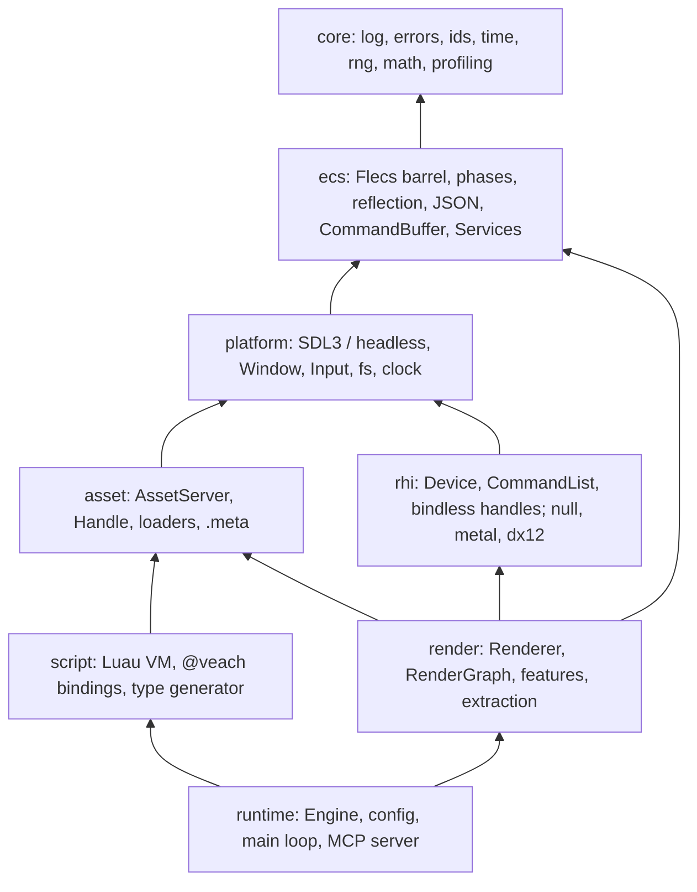
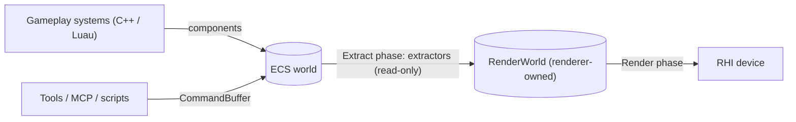

# Veach architecture

How the engine is put together, and the rules that keep it that way. Decisions behind each part live in
[adr/](adr/README.md); behavior is specified in [specs/](specs/README.md).

## Non-negotiables

Changing any of these needs the product owner's sign-off and a superseding ADR.

1. **The engine owns the main loop.** User code never calls `progress()`, never creates its own world, and
   never creates pipelines or threads. ([ADR 0014](adr/0014-engine-lifecycle-and-phases.md))
2. **Fixed phases.** `Startup → Input → Simulation → PostSimulation → TransformPropagation → PreExtract →
   Extract → Render → Shutdown`. User systems (C++ or Luau) attach to these; only the engine runs them.
3. **Renderer data lives outside the ECS.** BVHs, GPU buffers, light structures and reservoirs belong to the
   renderer. **Extraction is the only crossing point** from the ECS world into the renderer. Gameplay touches
   components (`Mesh`, `Material`, `Light`, `Camera`), never GPU handles.
   ([ADR 0016](adr/0016-renderer-data-and-extraction.md))
4. **Every component is reflected**, including script-defined ones. The engine refuses to start otherwise.
   ([ADR 0022](adr/0022-reflection-everywhere.md))
5. **Determinism.** Fixed 60 Hz simulation step, seeded RNG (`veach::Random`), no wall-clock time in
   simulation. Record/replay must stay possible.
6. **Text everywhere.** Scenes, configs and metadata are text. Logs are structured (JSON lines and readable
   console output).
7. **Errors tell you the fix**, with stable codes that link to [reference/errors.md](reference/errors.md).
   ([ADR 0021](adr/0021-structured-logging-and-errors.md))
8. **Headless first.** Every app runs with no window and no GPU for a fixed number of frames.
9. **Extension through Veach modules** (Flecs modules): engine features are modules, the game is a module,
   added with `engine.import<MyModule>()`. Not a plugin/app model. ([ADR 0015](adr/0015-veach-modules-and-services.md))
10. **Hardware target:** GPUs with hardware RT (DXR 1.1-class; Apple M3+). Goal: 60 fps at 1440p output with
    upscaling on current mid/high-end RT GPUs. ([ADR 0002](adr/0002-target-platforms-and-hardware.md))

## What is abstracted, and what is not

| Abstracted (we own an interface) | Not abstracted (used directly) |
|---|---|
| GPU API: a thin, modern-only RHI (bindless, hardware RT, no legacy paths): `engine/rhi` | Flecs semantics: aliased through `veach::`, not wrapped ([ADR 0005](adr/0005-flecs-barrel-not-wrapper.md)) |
| Platform/OS: windows, input, files, time (threads later): `engine/platform` | Slang: shaders are written in Slang ([ADR 0003](adr/0003-shaders-slang.md)) |
| Asset I/O: handles, loaders, `.meta` ids: `engine/asset` | Luau: no "multiple scripting languages" layer ([ADR 0006](adr/0006-scripting-luau.md)) |
| The Luau scripting surface: the curated `@veach` module: `engine/script` | |

## Layers

Each area is its own static library (`veach_<area>`, alias `veach::<area>`), so the layering is enforced by the
build ([ADR 0020](adr/0020-repository-layout.md)). Users include one header, `<veach/veach.hpp>`, and link
`veach::veach`.



- **core** depends only on glm (and Tracy when profiling). No Flecs, no SDL.
- **ecs** adds Flecs and nlohmann/json. Engine-owned, non-ECS objects (platform, assets, scripts, device,
  renderer) are reachable from a world through the `Services` registry, provided and revoked by init steps.
- **platform** is the only place SDL exists, and only in one `.cpp`. The RHI sees `NativeWindowHandle` only.
- **apps/** and **tools/** link the umbrella. They must not name Flecs directly (`veach::`, or `veach::ecs::`).

## Init and shutdown

`veach::Engine` resolves config first (CLI flags over `veach.project.json` over defaults; this only reads
files), then initializes:

```
core → platform → ecs → assets → script → rhi → render → modules
```

| Step | Creates |
|---|---|
| core | Log configuration (format, level), error counter |
| platform | `Platform` backend: `sdl3`, or `headless` (no SDL at all) |
| ecs | `World`, `CoreModule`, per-phase pipelines, `PlatformModule`, `Time`/`Random`, the primary window entity (OS window created here) |
| assets | `AssetServer` rooted at the project directory |
| script | `ScriptRuntime` (Luau VM), the `luau-script` loader |
| rhi | `rhi::Device` (null by default), plus a surface from the primary window's native handle |
| render | `Renderer` and `RenderModule` (Extract and Render systems) |
| modules | User modules in `import<T>()` order, then the reflection check |

Then `start()` loads the startup script through the asset system and runs Startup once. Shutdown runs the
Shutdown phase, then undoes the completed steps in exact reverse, each by RAII. A failed step unwinds only
what completed. The exit code is 0 only if nothing was logged at error level.
([spec](specs/engine-lifecycle/spec.md))

## The frame

```
Input                                   per frame       platform events → Input, actions, windows
Simulation → PostSimulation →
  TransformPropagation                  per fixed step  gameplay; dt = 1/60 s exactly
PreExtract → Extract → Render           per frame       ECS → RenderWorld → GPU
```

Headless runs with `--frames N` do exactly one fixed step per frame, unpaced, so they are deterministic.
Windowed runs use a fixed-timestep accumulator (at most 8 steps a frame), and sleep to 60 Hz until a
swapchain paces them. Each phase is its own Flecs pipeline. Phase tags are deliberately not `flecs::Phase`,
so Flecs's builtin pipeline never runs user systems. Within a phase, systems run in declaration order.

## Data flow: ECS → extraction → renderer



Extractors are registered by modules (`Renderer::add_extractor`) and are the only code that reads the ECS on
the renderer's behalf. The renderer never reads the ECS outside Extract, and gameplay never sees `RenderWorld`.

In the Render phase the renderer builds a **render graph** for the frame:

1. a clear of the scene color;
2. every registered `RenderFeature`'s passes;
3. present to the swapchain, and a screenshot readback when requested.

Passes declare every resource access. The graph derives execution order, culls unused passes, and emits
barriers and residency ([ADR 0025](adr/0025-sync-and-barrier-model.md)). Shaders reach resources through
bindless `DescriptorHandle`s in a small parameter block ([ADR 0024](adr/0024-resource-binding-model.md)), and
are compiled from Slang at build time for every target ([ADR 0026](adr/0026-shader-compilation.md)). Guide:
[rendering](guides/rendering.md).

## Scripting boundary

Luau scripts see only `require("@veach")`. Every invocation (a script's top level, or one run of a script
system) records its writes into a `CommandBuffer`, which is applied if the invocation returns and discarded if
it raises. A script system's query result crosses into Luau in one call; the per-entity loop runs in Luau.
Types (`types/veach.d.luau`) are generated from reflection. ([spec](specs/scripting-luau-api-v0/spec.md))

## Threading model

Single-threaded today: the main thread runs the loop, all phases and all scripts. A job system (enkiTS or
Taskflow, decided by ADR in VCH-015) arrives later, and Flecs worker threads will be hooked into it rather than
spawning their own. Asset loaders are written to be thread-safe from the start: they never touch the world.
Until then, script systems are `immediate()` and apply their command buffers directly after collecting their
batch. The CPU may run `frames_in_flight` frames ahead of the GPU (default 2; [ADR 0029](adr/0029-frame-and-sync-model.md)).
Destroyed GPU resources are released once the submissions that might use them complete.
GPU error callbacks arrive on Metal's thread, which is why the log and the engine's error counter are thread-safe.

## Where things live

| Path | Contents |
|---|---|
| `engine/<area>/include/veach/<area>/` | Public headers of an area |
| `engine/<area>/src/` | Implementation (private headers too) |
| `engine/include/veach/veach.hpp` | The umbrella header |
| `apps/lab/` | The prototype app (hello world, `veach.project.json`, `scripts/`) |
| `tools/veach-cli/` | `veach types`, `veach schemas` |
| `tools/scripts/` | Repo hygiene check, format hook |
| `tests/` | doctest unit tests plus CTest integration tests |
| `types/veach.d.luau`, `schemas/` | Generated from reflection, committed, checked by CTest |
| `docs/` | Vision, architecture, ADRs, specs, backlog, guides, error reference |
