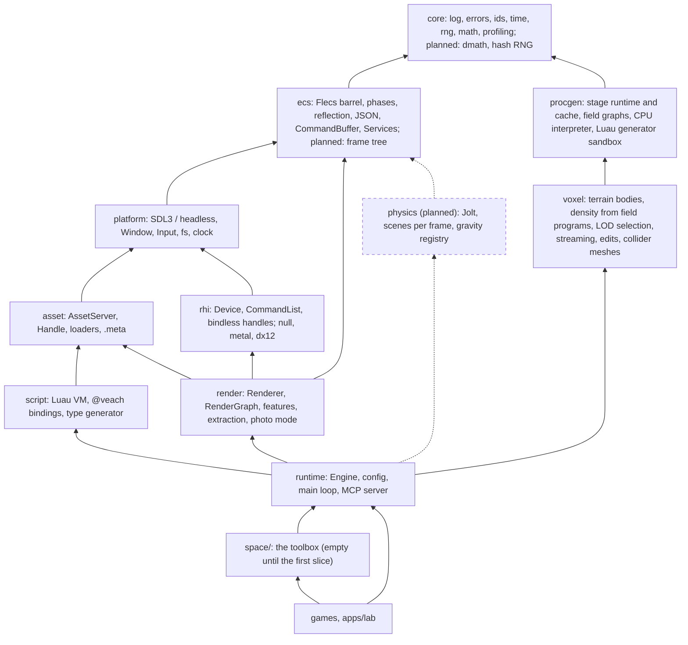
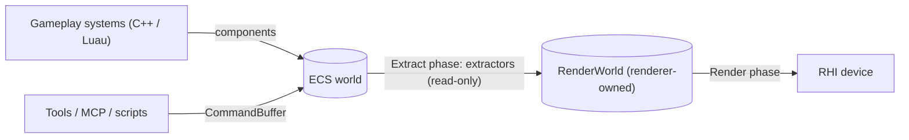

# Veach architecture

How the engine is put together, and the rules that keep it that way. Decisions behind each part live in
[adr/](adr/README.md); behavior is specified in [specs/](specs/README.md).

## Non-negotiables

Changing any of these needs the product owner's sign-off and a superseding ADR.

1. **The engine owns the main loop.** User code never calls `progress()`, never creates its own world, and
   never creates pipelines or threads. ([ADR 0018](adr/0018-engine-lifecycle-and-phases.md))
2. **Fixed phases.** `Startup → Input → Simulation → PostSimulation → TransformPropagation → PreExtract →
   Extract → Render → Shutdown`. User systems (C++ or Luau) attach to these; only the engine runs them.
3. **Renderer data lives outside the ECS.** GPU buffers, render targets, acceleration structures and light
   structures belong to the renderer. **Extraction is the only crossing point** from the ECS world into the
   renderer. Gameplay touches components (`SceneInstance`, lights, `Camera`, `Sky`), never GPU handles.
   ([ADR 0020](adr/0020-renderer-data-and-extraction.md))
4. **Every component is reflected**, including script-defined ones. The engine refuses to start otherwise.
   ([ADR 0026](adr/0026-reflection-everywhere.md))
5. **Determinism.** Fixed 60 Hz simulation step, no wall-clock time in simulation. Record/replay must stay
   possible. Every computation belongs to a determinism tier (#13): canonical work uses strict floating point,
   `veach::dmath` and counter-based hash randomness; gameplay code that runs only live keeps the seeded
   `veach::Random` stream. ([ADR 0043](adr/0043-determinism-tiers-and-strict-floating-point.md),
   [ADR 0044](adr/0044-counter-based-hash-randomness.md))
6. **Text everywhere.** Scenes, configs and metadata are text. Logs are structured (JSON lines and readable
   console output).
7. **Errors tell you the fix**, with stable codes that link to [reference/errors.md](reference/errors.md).
   ([ADR 0025](adr/0025-structured-logging-and-errors.md))
8. **Headless first.** Every app runs with no window and no GPU for a fixed number of frames.
9. **Extension through Veach modules** (Flecs modules): engine features are modules, the game is a module,
   added with `engine.import<MyModule>()`. Not a plugin/app model. ([ADR 0019](adr/0019-veach-modules-and-services.md))
10. **Hardware target:** every Apple silicon Mac (Metal 3) and DX12 GPUs with Shader Model 6.6, resource binding
    tier 3 and enhanced barriers. **Hardware ray tracing is optional** and used only by photo mode; no real-time
    feature may require it. **Performance target: 60 fps at 1440p with everything on, on an M3 Pro-class GPU**
    (the owner's decision, [ADR 0066](adr/0066-owner-decisions-research-phase.md)); a base M1-class GPU at 1080p60 on
    the low preset is the working minimum. ([ADR 0003](adr/0003-platforms-and-hardware-target.md))
11. **The real-time renderer is a rasterizer:** no real-time GI, no real-time path tracing.
    ([ADR 0039](adr/0039-realtime-renderer-is-raster-pbr.md)) The planned renderer is a GPU-driven visibility
    buffer with clustered lights and forward transparency
    ([ADR 0060](adr/0060-gpu-driven-visibility-buffer.md), superseding
    [ADR 0040](adr/0040-interim-realtime-path-visibility-buffer.md)).
12. **The engine never knows the space toolbox exists.** `space/` sits on top of `veach::veach`; nothing under
    `engine/` names it, and generic needs of the toolbox move down into the engine.
    ([ADR 0042](adr/0042-space-toolbox-layering.md))
13. **Determinism tiers.** *Canonical*: bit-identical on macOS arm64 and Windows x64, CPU only (seeds, addresses,
    generation stage records, orbits from ticks, terrain density at collider and edit resolution, gameplay
    placement, edit application, Luau generator hooks, aggregate simulation state). *Replay*: identical for the
    same binary on the same platform (fixed-step simulation, physics). *Visual*: all GPU work. Data flows only
    downward: canonical work never reads replay or visual results, and replay work never reads visual results.
    Quality presets never change simulation outcomes.
    ([ADR 0043](adr/0043-determinism-tiers-and-strict-floating-point.md),
    [ADR 0064](adr/0064-quality-presets.md))

## What is abstracted, and what is not

| Abstracted (we own an interface) | Not abstracted (used directly) |
|---|---|
| GPU API: a thin, modern-only RHI (bindless, optional ray tracing, no legacy paths): `engine/rhi` ([ADR 0004](adr/0004-own-rhi-not-sdl-gpu.md)) | Flecs semantics: aliased through `veach::`, not wrapped ([ADR 0006](adr/0006-flecs-barrel-not-wrapper.md)) |
| Platform/OS: windows, input, files, time (threads later): `engine/platform` | Slang: shaders are written in Slang ([ADR 0008](adr/0008-shaders-slang.md)) |
| Asset I/O: handles, loaders, `.meta` ids: `engine/asset` | Luau: no "multiple scripting languages" layer ([ADR 0007](adr/0007-scripting-luau.md)) |
| The Luau scripting surface: the curated `@veach` module: `engine/script` | |

## Layers

Each area is its own static library (`veach_<area>`, alias `veach::<area>`), so the layering is enforced by the
build ([ADR 0024](adr/0024-repository-layout.md)). Users include one header, `<veach/veach.hpp>`, and link
`veach::veach`. The space toolbox (`space/`, `veach::space`) is a layer on top that links `veach::veach` like any
game, and that the engine never sees. Dashed boxes are areas the research phase planned and that do not exist yet
([ADR 0065](adr/0065-engine-areas-for-the-toolbox.md) sets their exact dependencies).



- **core** depends only on glm (and Tracy when profiling). No Flecs, no SDL.
- **ecs** adds Flecs and nlohmann/json. Engine-owned, non-ECS objects (platform, assets, scripts, device,
  renderer) are reachable from a world through the `Services` registry, provided and revoked by init steps.
- **platform** is the only place SDL exists, and only in one `.cpp`. The RHI sees `NativeWindowHandle` only.
- **Planned areas** ([ADR 0065](adr/0065-engine-areas-for-the-toolbox.md)): double positions in a reference-frame
  tree, with camera-relative extraction, go into core and ecs; `engine/physics` keeps Jolt private the way
  `engine/platform` keeps SDL; `engine/procgen` and `engine/voxel` are generic, usable by a flat-world game. What is
  specific to space (galaxy, addresses, body kinds, orbits, planetary terrain bands, atmospheres from composition,
  flight and travel, simulation domains, the universe manifest) stays in `space/`.
- **apps/**, **tools/** and **space/** link the umbrella. Apps must not name Flecs directly (`veach::`, or
  `veach::ecs::`); `check_repo.py` checks it, and that nothing under `engine/` names the toolbox.

## Init and shutdown

`veach::Engine` resolves config first (CLI flags over `veach.project.json` over defaults; this only reads
files), then initializes:

```
core → jobs → platform → ecs → assets → script → rhi → render → modules
```

| Step | Creates |
|---|---|
| core | Log configuration (format, level), error counter |
| jobs | `JobSystem`: the worker threads (`jobs` / `--jobs`, default hardware threads − 1) |
| platform | `Platform` backend: `sdl3`, or `headless` (no SDL at all) |
| ecs | `World`, `CoreModule`, per-phase pipelines, `PlatformModule`, `Time`/`Random`, the primary window entity (OS window created here) |
| assets | `AssetServer` rooted at the project directory |
| script | `ScriptRuntime` (Luau VM), the `luau-script` loader |
| rhi | `rhi::Device` (null by default), plus a surface from the primary window's native handle |
| render | `Renderer` and `RenderModule` (Extract and Render systems) |
| modules | User modules in `import<T>()` order, then the reflection check |

Then `start()` loads the startup script through the asset system and runs Startup once. Shutdown runs the
Shutdown phase, waits for every queued job, then undoes the completed steps in exact reverse, each by RAII. A failed step unwinds only
what completed. The exit code is 0 only if nothing was logged at error level.
([spec](specs/engine-lifecycle/spec.md))

## The frame

```
Input                                   per frame       platform events → Input, actions, windows
Simulation → PostSimulation →
  TransformPropagation                  per fixed step  gameplay; dt = 1/60 s exactly
PreExtract → Extract → Render           per frame       ECS → RenderWorld → GPU
```

Headless runs with `--frames N` do exactly one fixed step per frame, unpaced, so they are deterministic.
Windowed runs use a fixed-timestep accumulator (at most 8 steps a frame), and sleep to 60 Hz until a
swapchain paces them. Each phase is its own Flecs pipeline. Phase tags are deliberately not `flecs::Phase`,
so Flecs's builtin pipeline never runs user systems. Within a phase, systems run in declaration order.

## Data flow: ECS → extraction → renderer



Extractors are registered by modules (`Renderer::add_extractor`) and are the only code that reads the ECS on
the renderer's behalf. The renderer never reads the ECS outside Extract, and gameplay never sees `RenderWorld`.

In the Render phase the renderer builds a **render graph** for the frame:

1. a clear of the scene color;
2. every registered `RenderFeature`'s passes;
3. present to the swapchain, and a screenshot readback when requested.

Passes declare every resource access. The graph derives execution order, culls unused passes, and emits
barriers and residency ([ADR 0029](adr/0029-render-graph-sync-and-barriers.md)). Shaders reach resources through
bindless `DescriptorHandle`s in a small parameter block ([ADR 0027](adr/0027-resource-binding-model.md)), and
are compiled from Slang at build time for every target ([ADR 0009](adr/0009-shader-compilation.md)). Guide:
[rendering](guides/rendering.md).

The scene renderer draws each camera one of two ways. Without `PhotoMode`, the **real-time renderer**: in code today
an interim visibility-buffer path with basic, unshadowed shading and no ray tracing
([ADR 0040](adr/0040-interim-realtime-path-visibility-buffer.md)). The planned renderer grows it into a GPU-driven
visibility buffer with clustered lights and forward transparency
([ADR 0060](adr/0060-gpu-driven-visibility-buffer.md), which supersedes 0040). Extraction will compute every
position camera-relative in double and hand the GPU float32 only, so `RenderWorld` holds no absolute positions
([ADR 0045](adr/0045-large-world-positions-and-reference-frames.md)). With `PhotoMode`, **photo mode**: the reference path tracer, accumulating while nothing changes, on devices with
hardware ray tracing ([ADR 0041](adr/0041-photo-mode.md)). Both share the Slang materials, lights, sky and display
transform.

## GPU compute for the toolbox

Authoritative terrain and procgen run on the CPU, headless and on the null RHI (dedicated servers, CI); GPU
evaluation and meshing are visual-only, and nothing flows from the GPU back into simulation
([ADR 0052](adr/0052-procgen-runtime.md), [ADR 0053](adr/0053-terrain-density-field.md)). The GPU's toolbox work is
rendering: culling, indirect draws, atmospheres, volumes. What the RHI offers today, per backend, is audited in
[reference/rhi-capabilities.md](reference/rhi-capabilities.md). In short: compute pipelines and dispatch,
read-write storage buffers and 2D storage textures, 32-bit buffer atomics, upload and readback buffers and several
submissions per frame all exist on Metal and DX12. Missing (VCH-071 to VCH-076, VCH-098): indirect dispatch and
draw and 3D textures and arrays, which block the renderer; blend state, depth bias, comparison samplers and
anisotropic filtering; texture updates after creation, texture and 64-bit atomics, an async compute queue, and a
non-blocking way to ask whether GPU work finished (off the critical path, since no authoritative work waits on the
GPU).

## Scripting boundary

Luau scripts see only `require("@veach")`. Every invocation (a script's top level, or one run of a script
system) records its writes into a `CommandBuffer`, which is applied if the invocation returns and discarded if
it raises. A script system's query result crosses into Luau in one call; the per-entity loop runs in Luau.
Types (`types/veach.d.luau`) are generated from reflection. ([spec](specs/scripting-luau-api-v0/spec.md))

## Threading model

The main thread runs the loop, all phases, all scripts and owns the World; nothing else touches it. Parallel work
runs on the engine's job system, `veach::JobSystem` on enkiTS ([ADR 0073](adr/0073-job-system-enkits.md),
[spec](specs/job-system/spec.md)), created in the `jobs` init step with `jobs` threads counting the main thread
(`--jobs N`, default hardware threads − 1; `--jobs 1` has no workers):

- `parallel_for` / `parallel_reduce` cut `[0, count)` into fixed chunks of `grain` items, independent of the thread
  count, and reduce in chunk order on the caller, so canonical results are the same on any machine
  ([ADR 0043](adr/0043-determinism-tiers-and-strict-floating-point.md)). `TaskGroup` runs independent jobs.
- Jobs never touch the World: inputs are prepared before the call, outputs go to indexed slots, the main thread
  applies them. Simulation never depends on when a job finishes.
- Nothing else starts threads: `check_repo.py` rejects `std::thread`, `std::async` and friends, and Flecs's own
  `set_threads`, outside the job system. The one exception is the MCP server's blocking stdin reader.
- Jolt's `JobSystemWithBarrier` (VCH-087), Flecs `multi_threaded()` systems (VCH-107) and the per-worker Luau procgen
  VMs run on the same workers.

Asset loaders are written to be thread-safe from the start: they never touch the world.
Script systems are `immediate()` and apply their command buffers directly after collecting their batch. The CPU may run `frames_in_flight` frames ahead of the GPU (default 2; [ADR 0030](adr/0030-frame-and-sync-model.md)).
Destroyed GPU resources are released once the submissions that might use them complete.
GPU error callbacks arrive on Metal's thread, which is why the log and the engine's error counter are thread-safe.

## Where things live

| Path | Contents |
|---|---|
| `engine/<area>/include/veach/<area>/` | Public headers of an area |
| `engine/<area>/src/` | Implementation (private headers too) |
| `engine/include/veach/veach.hpp` | The umbrella header |
| `engine/core/`, `engine/ecs/` (planned additions) | `veach::dmath`, counter-based hash RNG; double positions in a reference-frame tree ([ADR 0065](adr/0065-engine-areas-for-the-toolbox.md)) |
| `engine/physics/` (planned) | Jolt in double precision, one scene per frame, the gravity registry ([ADR 0058](adr/0058-physics-jolt.md)) |
| `engine/procgen/` | Generation stage runtime and cache, field-graph IR, JSON loader and canonical CPU interpreter, the Luau generator sandbox ([ADR 0052](adr/0052-procgen-runtime.md), [spec](specs/procgen/spec.md)). Links core only, never rhi or render |
| `engine/voxel/` | Terrain bodies on a body-local lattice: density from procgen field programs, the CPU mesher, octree LOD selection, streaming under a budget, the edit store, LOD0 collider meshes for physics ([ADR 0053](adr/0053-terrain-density-field.md), [ADR 0086](adr/0086-amendments-from-building-voxel.md), [spec](specs/voxel-terrain/spec.md)). Links core and procgen only; its ECS and render binding is `engine/runtime`'s `TerrainModule` |
| `space/` | The space toolbox: a layer above the engine, empty until the first slice (galaxy, addresses, body kinds, orbits, planetary terrain, atmospheres, flight and travel) |
| `apps/lab/` | The prototype app (`veach.project.json`, `scripts/`, sample assets, its own shaders and materials) |
| `tools/veach-cli/` | `veach types`, `veach schemas`, `veach imgdiff` |
| `tools/scripts/`, `tools/push.sh` | Repo hygiene check, the pre-push gate, format hook, leak check |
| `tools/metal-repros/` | Standalone repros of Metal compiler crashes we work around |
| `tests/` | doctest unit tests plus CTest integration tests |
| `types/veach.d.luau`, `schemas/` | Generated from reflection, committed, checked by CTest |
| `docs/` | Vision, architecture, ADRs, specs, backlog, guides, error reference |

## Toolbox architecture (decided in the research phase)

<a id="open-questions-research-phase"></a>

The research phase (VCH-070) answered the eight open questions it started with, plus three that the
[scope review](research/00-scope.md) added or split out. Each answer is an accepted ADR; the evidence is in the
research doc it links, and [the synthesis](research/00-synthesis.md) ties them together. Product choices (the hardware
target, the default scale, multiplayer scope, the first slice's contents) are left to the owner and listed there.
The numbering follows the original questions.

1. **Large-world coordinates.** Positions are doubles relative to a parent frame, and frames are entities in a
   tree (system barycenter → body orbit frame → body-fixed rotating frame → base or ship → ship interior); a star
   system is the largest continuous frame, and galaxy positions are int64 per axis (sector + local). There is no
   floating origin in simulation; the GPU sees only camera-relative float32, computed in double at extraction. Luau
   gets a double `Position` userdata, and 64-bit values cross Luau, JSON and MCP as strings or tagged userdata.
   ([ADR 0045](adr/0045-large-world-positions-and-reference-frames.md),
   [ADR 0046](adr/0046-64-bit-values-across-luau-json-mcp.md), [research](research/01-coordinates.md))
   - **Time and orbits** ride on the frame tree: an int64 universe tick at 60 Hz with exact orbital phase from
     integer periods; bodies on rails in a barycenter tree of registered motion models (Keplerian, fixed,
     scripted); the sky's suns and eclipses are queries of the system. Time warp: physics up to 4× and rails up to
     100,000× (as catch-up) in single player, none in multiplayer.
     ([ADR 0047](adr/0047-universe-clock.md), [ADR 0048](adr/0048-bodies-on-rails.md),
     [research](research/02-celestial-mechanics-time.md))
2. **Editable volumetric terrain.** A signed density field in chunked, body-local octrees, meshed on the CPU and
   canonical at collider and edit resolution, so servers and CI mesh it headless; the mesher (Transvoxel or surface
   nets) is picked by spike VCH-084. Edits travel and are journaled as versioned fixed-point brush operations,
   ordered by the server per body; at rest each LOD0 chunk keeps sparse absolute override samples with the hash of
   the generator output they were made on, and coarse LODs derive from them. Water is stored as levels.
   ([ADR 0053](adr/0053-terrain-density-field.md), [ADR 0054](adr/0054-terrain-edits-and-water.md),
   [research](research/04-terrain.md))
3. **Seed hierarchy and procgen determinism.** Elite-style layered octree addresses (64-bit system addresses with
   typed body, surface, chunk and object sub-addresses); every seed is a hash of the universe seed, the address,
   the stage id and the stage version. Generation is a pipeline of typed physical records, cached and versioned,
   registered by stable string id and run in id order; no stage reads the scale factors. Player edits sit on top
   (entries 2 and 10). ([ADR 0050](adr/0050-universe-addresses-and-seeds.md),
   [ADR 0051](adr/0051-staged-generation-pipeline.md), [research](research/03-generation-pipeline.md))
4. **The procgen graph model.** Code-first C++ stages plus JSON field graphs with versioned nodes and a Luau
   builder. The CPU interpreter is authoritative; GPU evaluation is visual-only. Users extend generation with Luau
   hooks in a procgen sandbox (one VM per worker, deterministic math, no world access, a time budget). The runtime
   is the generic `engine/procgen`. ([ADR 0052](adr/0052-procgen-runtime.md), [research](research/05-procgen-graph.md))
5. **The networking model.** Server-authoritative replication with client prediction, never lockstep: one world per
   process with an authority role, and the server owns the clock. Clients regenerate canonical content and receive
   edits and replicated state; a universe manifest handshake refuses a client whose generators or mods differ.
   ([ADR 0056](adr/0056-server-authoritative-multiplayer.md), [research](research/06-networking.md))
6. **Simulation LOD.** Four tiers per observer (live, reduced, aggregate, dormant) with radii in meters; state is a
   baseline plus persisted deviations plus clock functions. Catch-up goes clock function → closed form → event
   jumps → capped coarse steps → snap to baseline, and CI checks that live and caught-up states hash equal. Only
   player-caused changes fold back. ([ADR 0057](adr/0057-simulation-lod.md), [research](research/07-simulation-lod.md))
7. **The real-time renderer.** The visibility buffer grows into a GPU-driven one (meshlet culling, indirect draws,
   material-binned compute shading, a clustered light grid, a forward pass for transparents), with temporal
   accumulation at native resolution and no upscaling. Shadows are cascaded near and analytic far (planets,
   eclipses, rings); ambient is sky SH plus GTAO, reflections SSR plus probes. Per-body atmospheres come from
   composition with N suns; depth is reverse-Z infinite and camera-relative; auto-exposure is a GPU histogram with
   pre-exposure. Quality presets never change simulation outcomes.
   ([ADR 0060](adr/0060-gpu-driven-visibility-buffer.md), [ADR 0061](adr/0061-temporal-accumulation-no-upscaling.md),
   [ADR 0062](adr/0062-shadows-ambient-reflections.md), [ADR 0063](adr/0063-astronomical-rendering.md),
   [ADR 0064](adr/0064-quality-presets.md), [research](research/08-renderer.md))
8. **Physics at planetary scale.** Jolt, in double precision and built cross-platform-deterministic, private to
   `engine/physics`. One physics scene per active frame (a body-fixed surface region, a ship interior, a co-moving
   free ship) with transfers scheduled by tick; terrain colliders are meshed on the CPU from canonical density near
   moving bodies and installed at a fixed tick offset. Box3D is re-evaluated at its 1.0.
   ([ADR 0058](adr/0058-physics-jolt.md), [research](research/09-physics.md))
9. **Gravity, flight and travel.** Gravity comes from the dominant body by sphere of influence with μ = g·R², and
   artificial gravity volumes override it; flight models are plug-ins. A travel governor caps speed at
   max(v_floor, d/τ) in meters, so travel times are the same at every scale and terrain streaming has a known
   approach rate. ([ADR 0059](adr/0059-gravity-flight-travel.md), [research](research/10-gravity-flight-travel.md))
10. **Persistence and generator versioning.** `universe.json` holds an immutable genesis (id, seed, scale factors,
    creator settings, determinism contract version) and append-only epochs (stage versions, mods by hash). A body
    pins to the current epoch when first anchored (an edit, a placed object, a discovery); old stage versions stay
    runnable, and bake migration is the only way to retire one. Saves are canonical JSON plus per-chunk compressed
    region files, one format for single player and servers.
    ([ADR 0055](adr/0055-universe-identity-and-versioning.md), [research](research/11-persistence-versioning.md))
11. **Numeric determinism.** The three tiers of non-negotiable #13. Strict floating point on every CPU target
    (`-ffp-contract=off`, no fast-math; MSVC `/fp:precise` with contraction off), correctly rounded transcendentals
    in `veach::dmath`, and stateless counter-based hash randomness for procgen and simulation LOD. CI compares
    canonical hashes between the macOS arm64 gate and Windows x64 CI.
    ([ADR 0043](adr/0043-determinism-tiers-and-strict-floating-point.md),
    [ADR 0044](adr/0044-counter-based-hash-randomness.md), [research](research/12-determinism.md))

**Scale model.** A universe is generated at physical size and scaled by three factors
([ADR 0049](adr/0049-scale-model.md)). `s_p` (body scale) scales planet, moon and asteroid radii, moon orbits
around their planet, planetary-band terrain (continents, mountain ranges, ocean basins) and river widths.
`s_o` (orbit scale) scales planet orbits around stars, star radii and binary separations; it equals `s_p` unless a
creator separates them. `s_a` (atmosphere scale, `sqrt(s_p)` by default) scales atmosphere thickness and scale
heights, with scattering coefficients divided by `s_a` so the sky keeps its color. Never scaled, always in meters:
players, creatures, props, buildings, ships, caves, edit brushes, the LOD0 cell size, detail-band terrain and
human-scale haze. Surface gravity stays physical, so GM = g·R² and orbital periods follow the square root of the
scale. No generation stage reads a scale factor; scale applies when records become geometry, and it is fixed in
the genesis once anything is anchored. The defaults are the owner's decision (the recommendation is s = 0.1, with
0.01 to 1 supported).

**Next milestone:** the spike plan toward the first slice, VCH-077 to VCH-091 in the
[backlog](backlog/BACKLOG.md). Each spike is a throwaway prototype with a visible success criterion; the first
slice (VCH-091) is a seed-generated star system you fly down into, land on and dig, with the same code at
s = 0.01 and s = 1.
