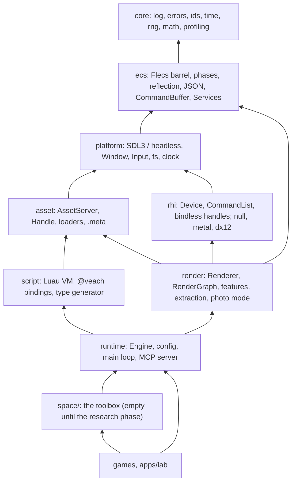
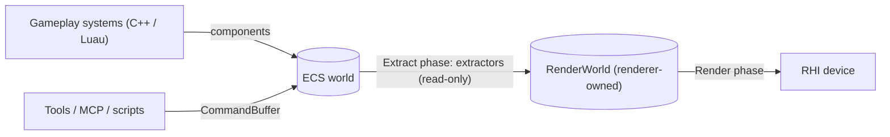

# Veach architecture

How the engine is put together, and the rules that keep it that way. Decisions behind each part live in
[adr/](adr/README.md); behavior is specified in [specs/](specs/README.md).

## Non-negotiables

Changing any of these needs the product owner's sign-off and a superseding ADR.

1. **The engine owns the main loop.** User code never calls `progress()`, never creates its own world, and
   never creates pipelines or threads. ([ADR 0018](adr/0018-engine-lifecycle-and-phases.md))
2. **Fixed phases.** `Startup → Input → Simulation → PostSimulation → TransformPropagation → PreExtract →
   Extract → Render → Shutdown`. User systems (C++ or Luau) attach to these; only the engine runs them.
3. **Renderer data lives outside the ECS.** GPU buffers, render targets, acceleration structures and light
   structures belong to the renderer. **Extraction is the only crossing point** from the ECS world into the
   renderer. Gameplay touches components (`SceneInstance`, lights, `Camera`, `Sky`), never GPU handles.
   ([ADR 0020](adr/0020-renderer-data-and-extraction.md))
4. **Every component is reflected**, including script-defined ones. The engine refuses to start otherwise.
   ([ADR 0026](adr/0026-reflection-everywhere.md))
5. **Determinism.** Fixed 60 Hz simulation step, seeded RNG (`veach::Random`), no wall-clock time in
   simulation. Record/replay must stay possible.
6. **Text everywhere.** Scenes, configs and metadata are text. Logs are structured (JSON lines and readable
   console output).
7. **Errors tell you the fix**, with stable codes that link to [reference/errors.md](reference/errors.md).
   ([ADR 0025](adr/0025-structured-logging-and-errors.md))
8. **Headless first.** Every app runs with no window and no GPU for a fixed number of frames.
9. **Extension through Veach modules** (Flecs modules): engine features are modules, the game is a module,
   added with `engine.import<MyModule>()`. Not a plugin/app model. ([ADR 0019](adr/0019-veach-modules-and-services.md))
10. **Hardware target:** every Apple silicon Mac (Metal 3) and DX12 GPUs with Shader Model 6.6, resource binding
    tier 3 and enhanced barriers. **Hardware ray tracing is optional** and used only by photo mode; no real-time
    feature may require it. Design target: 60 fps at 1080p on a base Apple M1-class GPU.
    ([ADR 0003](adr/0003-platforms-and-hardware-target.md))
11. **The real-time renderer is a rasterizer:** no real-time GI, no real-time path tracing.
    ([ADR 0039](adr/0039-realtime-renderer-is-raster-pbr.md))
12. **The engine never knows the space toolbox exists.** `space/` sits on top of `veach::veach`; nothing under
    `engine/` names it, and generic needs of the toolbox move down into the engine.
    ([ADR 0042](adr/0042-space-toolbox-layering.md))

## What is abstracted, and what is not

| Abstracted (we own an interface) | Not abstracted (used directly) |
|---|---|
| GPU API: a thin, modern-only RHI (bindless, optional ray tracing, no legacy paths): `engine/rhi` ([ADR 0004](adr/0004-own-rhi-not-sdl-gpu.md)) | Flecs semantics: aliased through `veach::`, not wrapped ([ADR 0006](adr/0006-flecs-barrel-not-wrapper.md)) |
| Platform/OS: windows, input, files, time (threads later): `engine/platform` | Slang: shaders are written in Slang ([ADR 0008](adr/0008-shaders-slang.md)) |
| Asset I/O: handles, loaders, `.meta` ids: `engine/asset` | Luau: no "multiple scripting languages" layer ([ADR 0007](adr/0007-scripting-luau.md)) |
| The Luau scripting surface: the curated `@veach` module: `engine/script` | |

## Layers

Each area is its own static library (`veach_<area>`, alias `veach::<area>`), so the layering is enforced by the
build ([ADR 0024](adr/0024-repository-layout.md)). Users include one header, `<veach/veach.hpp>`, and link
`veach::veach`. The space toolbox (`space/`, `veach::space`) is a layer on top that links `veach::veach` like any
game, and that the engine never sees.



- **core** depends only on glm (and Tracy when profiling). No Flecs, no SDL.
- **ecs** adds Flecs and nlohmann/json. Engine-owned, non-ECS objects (platform, assets, scripts, device,
  renderer) are reachable from a world through the `Services` registry, provided and revoked by init steps.
- **platform** is the only place SDL exists, and only in one `.cpp`. The RHI sees `NativeWindowHandle` only.
- **apps/**, **tools/** and **space/** link the umbrella. Apps must not name Flecs directly (`veach::`, or
  `veach::ecs::`); `check_repo.py` checks it, and that nothing under `engine/` names the toolbox.

## Init and shutdown

`veach::Engine` resolves config first (CLI flags over `veach.project.json` over defaults; this only reads
files), then initializes:

```
core → platform → ecs → assets → script → rhi → render → modules
```

| Step | Creates |
|---|---|
| core | Log configuration (format, level), error counter |
| platform | `Platform` backend: `sdl3`, or `headless` (no SDL at all) |
| ecs | `World`, `CoreModule`, per-phase pipelines, `PlatformModule`, `Time`/`Random`, the primary window entity (OS window created here) |
| assets | `AssetServer` rooted at the project directory |
| script | `ScriptRuntime` (Luau VM), the `luau-script` loader |
| rhi | `rhi::Device` (null by default), plus a surface from the primary window's native handle |
| render | `Renderer` and `RenderModule` (Extract and Render systems) |
| modules | User modules in `import<T>()` order, then the reflection check |

Then `start()` loads the startup script through the asset system and runs Startup once. Shutdown runs the
Shutdown phase, then undoes the completed steps in exact reverse, each by RAII. A failed step unwinds only
what completed. The exit code is 0 only if nothing was logged at error level.
([spec](specs/engine-lifecycle/spec.md))

## The frame

```
Input                                   per frame       platform events → Input, actions, windows
Simulation → PostSimulation →
  TransformPropagation                  per fixed step  gameplay; dt = 1/60 s exactly
PreExtract → Extract → Render           per frame       ECS → RenderWorld → GPU
```

Headless runs with `--frames N` do exactly one fixed step per frame, unpaced, so they are deterministic.
Windowed runs use a fixed-timestep accumulator (at most 8 steps a frame), and sleep to 60 Hz until a
swapchain paces them. Each phase is its own Flecs pipeline. Phase tags are deliberately not `flecs::Phase`,
so Flecs's builtin pipeline never runs user systems. Within a phase, systems run in declaration order.

## Data flow: ECS → extraction → renderer



Extractors are registered by modules (`Renderer::add_extractor`) and are the only code that reads the ECS on
the renderer's behalf. The renderer never reads the ECS outside Extract, and gameplay never sees `RenderWorld`.

In the Render phase the renderer builds a **render graph** for the frame:

1. a clear of the scene color;
2. every registered `RenderFeature`'s passes;
3. present to the swapchain, and a screenshot readback when requested.

Passes declare every resource access. The graph derives execution order, culls unused passes, and emits
barriers and residency ([ADR 0029](adr/0029-render-graph-sync-and-barriers.md)). Shaders reach resources through
bindless `DescriptorHandle`s in a small parameter block ([ADR 0027](adr/0027-resource-binding-model.md)), and
are compiled from Slang at build time for every target ([ADR 0009](adr/0009-shader-compilation.md)). Guide:
[rendering](guides/rendering.md).

The scene renderer draws each camera one of two ways. Without `PhotoMode`, the **real-time renderer**: today an
interim visibility-buffer path with basic, unshadowed shading and no ray tracing
([ADR 0040](adr/0040-interim-realtime-path-visibility-buffer.md)); the real PBR rasterizer is designed in the research
phase. With `PhotoMode`, **photo mode**: the reference path tracer, accumulating while nothing changes, on devices with
hardware ray tracing ([ADR 0041](adr/0041-photo-mode.md)). Both share the Slang materials, lights, sky and display
transform.

## GPU compute for the toolbox

The toolbox will run much of its work on the GPU (terrain meshing, procgen, culling) and hand some results to CPU
systems (physics). What the RHI offers today, per backend, is audited in
[reference/rhi-capabilities.md](reference/rhi-capabilities.md). In short: compute pipelines and dispatch,
read-write storage buffers and 2D storage textures, 32-bit buffer atomics, upload and readback buffers and several
submissions per frame all exist on Metal and DX12. Missing, and tracked as research-phase inputs (VCH-071 to
VCH-076): indirect dispatch and draw, 3D textures and arrays, texture updates after creation, texture and 64-bit
atomics, a non-blocking way to ask whether GPU work finished, and an async compute queue.

## Scripting boundary

Luau scripts see only `require("@veach")`. Every invocation (a script's top level, or one run of a script
system) records its writes into a `CommandBuffer`, which is applied if the invocation returns and discarded if
it raises. A script system's query result crosses into Luau in one call; the per-entity loop runs in Luau.
Types (`types/veach.d.luau`) are generated from reflection. ([spec](specs/scripting-luau-api-v0/spec.md))

## Threading model

Single-threaded today: the main thread runs the loop, all phases and all scripts. A job system (enkiTS or
Taskflow, decided by ADR in VCH-015) arrives later, and Flecs worker threads will be hooked into it rather than
spawning their own. Asset loaders are written to be thread-safe from the start: they never touch the world.
Until then, script systems are `immediate()` and apply their command buffers directly after collecting their
batch. The CPU may run `frames_in_flight` frames ahead of the GPU (default 2; [ADR 0030](adr/0030-frame-and-sync-model.md)).
Destroyed GPU resources are released once the submissions that might use them complete.
GPU error callbacks arrive on Metal's thread, which is why the log and the engine's error counter are thread-safe.

## Where things live

| Path | Contents |
|---|---|
| `engine/<area>/include/veach/<area>/` | Public headers of an area |
| `engine/<area>/src/` | Implementation (private headers too) |
| `engine/include/veach/veach.hpp` | The umbrella header |
| `space/` | The space toolbox: a layer above the engine, empty until the research phase |
| `apps/lab/` | The prototype app (`veach.project.json`, `scripts/`, sample assets, its own shaders and materials) |
| `tools/veach-cli/` | `veach types`, `veach schemas`, `veach imgdiff` |
| `tools/scripts/`, `tools/push.sh` | Repo hygiene check, the pre-push gate, format hook, leak check |
| `tools/metal-repros/` | Standalone repros of Metal compiler crashes we work around |
| `tests/` | doctest unit tests plus CTest integration tests |
| `types/veach.d.luau`, `schemas/` | Generated from reflection, committed, checked by CTest |
| `docs/` | Vision, architecture, ADRs, specs, backlog, guides, error reference |

## Open questions (research phase)

The next milestone (VCH-070) answers these, each with an ADR and, where it needs evidence, a spike. No toolbox
feature is built before its questions are answered.

1. **Large-world coordinates.** Floating origin, double precision or 64-bit integer positions, and how they flow
   through the ECS, physics, extraction and rendering.
2. **Editable volumetric terrain.** Its representation and LOD: SDF or density fields, meshing, seams between LODs,
   chunk streaming, caves.
3. **Seed hierarchy and procgen determinism.** Galaxy → system → planet → biome → chunk → object, and how player
   edits are stored on top of what the seeds generate.
4. **The procgen graph model.** What runs in C++ or GPU compute, what is Luau, and how users extend it: the foundation
   for a nature editor.
5. **The networking model.** Authority, edits as deltas, what is synced and what is regenerated, and how it fits the
   fixed-step determinism the engine already has.
6. **Simulation LOD** for fauna, flora, NPCs and factions.
7. **The real-time PBR renderer on the existing render graph.** Forward+/clustered or visibility buffer, and how
   planet-scale render features (an atmosphere driven by composition, terrain, vegetation, oceans, clouds) plug in as
   `RenderFeature`s.
8. **Physics at planetary scale.** Box3D or Jolt with double precision.
