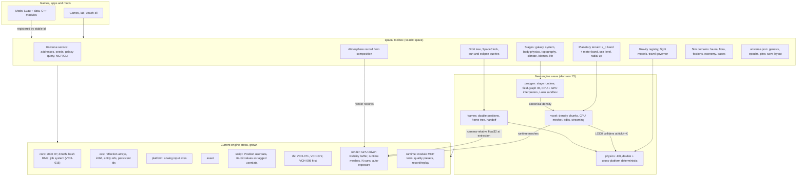

# 00: Synthesis — one architecture for the space toolbox

This document turns the twelve research answers ([01](./01-coordinates.md) to [12](./12-determinism.md), scoped by
[00-scope.md](./00-scope.md)) into one proposed architecture. It answers the `00-synthesis.md` bullet of the owner's
brief ([notes/_brief.md](./notes/_brief.md), "Output"). The dev lead's cross-question decisions
([notes/_decisions.md](./notes/_decisions.md)) are binding here: where a research doc disagrees with them, the
decision wins, and section 3 lists each research recommendation that was overridden. Nothing here is a new decision.
What is still undecided is in section 13.

Marking: **(derived)** is arithmetic done for this document or a research doc from stated rules; **(estimate)** is
a number not measured on the hardware it describes; **(unverified)** is a claim no primary source confirmed.

## 1. Summary

**The architecture in plain language.** A universe is a seed, a scale setting and a list of generator versions and
mods, written once into `universe.json`. Everything else is regenerated from that on demand: the galaxy, its systems,
their bodies, each body's climate, biomes and life, and the terrain under your feet. Generation is a pipeline of
stages that produce records in physical units (Earth is 6,371 km in the records at every scale). Scale is applied
only when records become geometry: three factors, s_p for bodies, s_o for orbits and s_a for atmospheres, turn
physical sizes into the sizes you fly around. Surface gravity stays physical, so orbits and years follow √s.

Bodies move on rails, as pure functions of an int64 universe tick. Positions are doubles relative to a tree of
reference frames (system → body orbit → rotating body → base or ship → ship interior). The GPU only ever sees
float32 positions relative to the camera, computed in double at extraction. Terrain is a signed density field per
body, meshed on the CPU in a body-local octree. Edits are fixed-point brush operations on the wire and absolute
override samples at rest. Physics is Jolt in double precision, one small scene per active frame. Multiplayer is a
server that owns the truth; clients regenerate the universe and receive only what changed.

All of it rests on a determinism contract in three tiers. **Canonical** results (seeds, orbits, terrain at collider
resolution, placement, edits, Luau generators) are bit-identical on Mac arm64 and Windows x64 and run on the CPU
only. **Replay** results (simulation, physics) repeat on the same binary and platform. **Visual** results (all GPU
work) only have to look right. Data flows downward only. The renderer grows today's visibility buffer into a
GPU-driven one, with per-body atmospheres around any planet, N suns, auto-exposure and native-resolution temporal
accumulation. Generic machinery moves down into `engine/` (frames, physics, procgen, voxel, strict math, job
system). Everything space-specific stays in `space/`.

**The five things most expensive to undo:**

1. **The determinism contract, `veach::dmath` and the hash function.** Changing any of them changes every canonical
   bit of every universe ([12](./12-determinism.md) §9, [05](./05-procgen-graph.md) §10).
2. **Universe addresses and seed derivation** (address layout, salts from stable string ids, the stage-seed formula).
   They end up in every save, edit, wire message and share code ([03](./03-generation-pipeline.md) §8).
3. **Frame-relative double positions and camera-relative rendering.** Every script, save, network message and
   shader written afterwards assumes them ([01](./01-coordinates.md) §8).
4. **The terrain storage format:** LOD0 cell and chunk size, sample encoding and absolute overrides keyed by
   `base_hash`. Changing any of them invalidates every edited body ([04](./04-terrain.md) §8).
5. **Universe identity:** scale fixed in an immutable genesis, append-only epochs, stability classes and body
   pinning. Every save and server world depends on what "the same universe" means ([11](./11-persistence-versioning.md) §9).

Close behind: the clock (int64 ticks at 60 Hz), the gravity rule (GM ∝ scale²) and the travel governor's cap law.

## 2. How the pieces fit

The engine never names `space/` ([ADR 0042](../adr/0042-space-toolbox-layering.md)). `engine/voxel`,
`engine/procgen` and `engine/physics` work for a flat-world game too. Spheres, s, sea level and orbits belong to the
toolbox.

## 3. Cross-question resolutions

| # | Conflict | What the research said | Decided |
|---|---|---|---|
| 1 | Multiplayer model | Q6 and Q12: server authority with prediction; lockstep would make all simulation canonical. Q1 kept an int64 fallback for lockstep | Server-authoritative, never lockstep. Doubles inside frames; no int64 fallback. Physics is replay tier |
| 2 | Determinism | Q12: three tiers, strict flags, CR dmath, hashing. Q2, Q4, Q5, Q9 each assumed parts of it | Q12's tiers are the contract every system signs; `veach::Random` stays for live gameplay only |
| 3 | Edit storage | Q4: ops, stored as absolute overrides. Q11: op log compacted into relative deltas with `base_hash`. Q6: ops on the wire | Ops on the wire and in the journal; absolute int16 + u8 overrides per LOD0 chunk with `base_hash` at rest; coarse LODs derived from LOD0; eruptions on the same path |
| 4 | CPU or GPU terrain | Q4: CPU mesher authoritative. Q6: servers have no GPU. Q8 and Q10 assumed GPU-meshed chunks | CPU interpreter and mesher are canonical and headless; GPU is visual-only, later. VCH-073 leaves the critical path |
| 5 | Scale | Q2: GM ∝ s² for all bodies. Q3: no stage reads s; s_p, s_sys, s_gal. Q5: relief exponent. Q8: separate s_atm. Q10: atmosphere ∝ √s | s_p, s_o (= s_p by default), s_a = √s_p; fixed g; validated day length; relief exponent 0.5; scale in genesis; governor in meters |
| 6 | Coordinates | Q1: frame-tree doubles, integer galaxy, camera-relative float32. Q8: no float32 world positions on the GPU | Q1's design, photo-mode TLAS included; Luau `Position`; 64-bit values as strings or tagged userdata |
| 7 | Time | Q2: int64 tick, exact phase, rails, warp only in single player. Q6, Q7: server clock, warp is catch-up | Q2's design: motion-model registry, N suns and occluder queries, physics warp ≤ 4×, rails warp ≤ 100,000× |
| 8 | Renderer | Q8: grow the visibility buffer; temporal reuse reverses part of the reset, so the owner decides | Visibility buffer grown (supersedes [ADR 0040](../adr/0040-interim-realtime-path-visibility-buffer.md)); native-resolution temporal accumulation is AA, not upscaling, so it fits [ADR 0039](../adr/0039-realtime-renderer-is-raster-pbr.md) |
| 9 | Physics | Q9: Jolt double + cross-platform, small scenes, colliders at a fixed tick | Q9's design; Box3D re-evaluated at 1.0 |
| 10 | Generation | Q3: octree addresses, physical stages, galaxy query. Q5: stages + field graphs. Q11: stability classes | Merged into one pipeline with registries in stable-id order, a Luau procgen sandbox and a universe query service |
| 11 | Persistence | Q11: genesis + epochs, pin on anchor, old versions runnable | Q11's design with decision 3's edit form; one format for single player and servers |
| 12 | Sim LOD | Q7: four tiers, baseline + deltas + clock functions | Q7's design, integer aggregates, clock-aligned staggered ticks |
| 13 | Engine vs toolbox | Q1, Q4, Q5, Q6, Q9, Q11 each proposed pieces that move down | Engine: frames, strict FP + dmath + hash RNG, jobs, physics, procgen, voxel, runtime meshes, reflection, persistent ids, module MCP tools, analog axes, quality presets. Toolbox: the space-specific rest |

**Research recommendations overridden, one line each:**

- Q3 §7.2's sequential `veach::Rng` inside a stage → a stateless hash RNG, so draws never depend on call order (decision 2).
- Q11 §4.4's relative density deltas → Q4's absolute override samples at rest; ops stay the wire and journal form (decision 3).
- Q8 §5 and Q10 §6's GPU-meshed terrain read back into colliders → CPU meshing only, so servers and CI need no GPU (decision 4).
- Q3 §11's relief factor default 1 → relief exponent 0.5 (Q5): an 88 m Everest at s = 0.01 is too tame (decision 5).
- Q8 §11's s_atm = s_p with a ~10 km floor → s_a = √s_p (Q10), so entry fits the streaming budget; 31.6 km at s = 0.1, not 10 km (decision 5).
- 00-scope's and Q3's galactic factor s_gal → int64 galaxy positions that never scale; galaxy size is its own setting (decision 6, packet 7).
- 00-scope §5's "eclipses need one factor" → Q2's correction: moons follow s_p, stars s_o, so angular sizes hold (decision 5).
- Q2 §4.3's creator-set solar day → physical sidereal period × multiplier, validated (decision 5).
- Q1 §11's per-body flag for fictitious forces → none, in every body-fixed frame (decision 6, packet 5).
- Q8 §11's temporal foundation and quality tiers as owner calls → engineering ADRs 0061 and 0064; the target stays the owner's (decision 8).
- Q6 §5's `uint64` tick → int64 (decision 7).
- Q10 §7's streaming constants (156/τ chunks/s) → Q4's measured budgets, in the descent spike (decision 5).

## 4. The scale model

All three factors live in genesis and are immutable once anything is anchored
([ADR 0049](../adr/0049-scale-model.md), [ADR 0055](../adr/0055-universe-identity-and-versioning.md)).

| Factor | Applies to | Default |
|---|---|---|
| s_p (body) | Planet, moon and asteroid radii; moon orbits around their planet; planetary-band terrain (continents, ranges, basins); sea-level radius; river topology, with widths from scaled catchments above a meter floor | Default pending owner, recommendation 0.1 |
| s_o (orbit) | Planet orbits around stars, star radii, binary separations | s_o = s_p; separating them is an advanced creator setting |
| s_a (atmosphere) | Atmosphere top, scale heights, cloud-layer heights; coefficients × 1/s_a so vertical optical depth and sky color stay the same | Default pending owner, recommendation √s_p |

**Never scaled:** players, creatures, props, buildings, ships, caves and cave-band depth, edit brushes, LOD0 cell
size, detail-band terrain, density per m², human-scale haze, the governor's cap, illuminance (physical luminosity and
distance), and every pipeline record (temperature, composition, biome). Galaxy positions are int64 and never scale.

**Derived quantities** for an Earth-like planet (R = 6,371 km, g = 9.81 m/s², 23.93 h sidereal day) at 1 AU from
a Sun-like star, with s_p = s_o = s and s_a = √s ([NSSDC](https://nssdc.gsfc.nasa.gov/planetary/factsheet/)). All
values are (derived) unless a doc is cited.

| Quantity | Rule | s = 0.01 | s = 0.1 | s = 1 | Kind |
|---|---|---|---|---|---|
| Radius | s_p · R_phys | 63.7 km | 637 km | 6,371 km | Derived |
| Surface gravity | physical × multiplier | 9.81 m/s² | 9.81 | 9.81 | Creator setting: default pending owner, recommendation ×1 |
| Planet GM | g·R², ∝ s_p² | 3.99e10 m³/s² | 3.99e12 | 3.99e14 | Derived |
| Star GM | ∝ s_o² | 1.33e16 m³/s² | 1.33e18 | 1.33e20 | Derived |
| Low-orbit speed | √(gR) | 791 m/s | 2.50 km/s | 7.91 km/s | Derived ([10](./10-gravity-flight-travel.md) §7) |
| Surface orbital period (= breakup period) | 2π√(R/g) | 8.4 min | 26.7 min | 84.4 min | Derived |
| Escape speed | √(2gR) | 1.12 km/s | 3.54 km/s | 11.2 km/s | Derived |
| Planet orbital speed | √(GM★/a), ∝ √s_o | 2.98 km/s | 9.42 km/s | 29.8 km/s | Derived |
| Year | ∝ √s_o | 36.5 d | 115 d | 365 d | Derived (a multiplier is open, §13) |
| Moon's month | ∝ √s_p | 2.7 d | 8.6 d | 27.3 d | Derived ([02](./02-celestial-mechanics-time.md) §6) |
| Sidereal day | physical × multiplier | 23.93 h | 23.93 h | 23.93 h | Creator setting: default pending owner, recommendation ×1 |
| Solar day | 1/T_sid − 1/T_year | 24.6 h | 24.1 h | 24.0 h | Derived |
| Day-length warning / refusal (equatorial speed > 30% / 70% of orbital) | T_orb/0.3, T_orb/0.7 | 28 / 12 min | 1.5 h / 38 min | 4.7 / 2.0 h | Fixed rule ([09](./09-physics.md) §11) |
| Equatorial speed, 24 h day | 2πR/T | 4.6 m/s | 46 m/s | 463 m/s | Derived |
| Atmosphere top | 100 km × s_a | 10 km | 31.6 km | 100 km | Derived from s_a |
| Atmosphere top / radius | | 15.7% | 5.0% | 1.6% | Derived: thicker limbs at small s |
| Rayleigh scale height (8 km on Earth) | × s_a | 0.8 km | 2.5 km | 8 km | Derived |
| Vertical optical depth | coefficients × 1/s_a | unchanged | unchanged | unchanged | Fixed by construction ([08](./08-renderer.md) §2.11) |
| Optical depth over a 1 km sight line, haze band off | × 1/s_a | 10× | 3.2× | 1× | Derived; the haze band corrects it (default pending owner, recommendation on) |
| Horizon from 2 m / from 1 km | √(2Rh + h²) | 0.5 / 11.3 km | 1.6 / 35.7 km | 5.0 / 113 km | Derived |
| Curvature drop over 1 km | x²/2R | 7.8 m | 0.78 m | 7.8 cm | Derived |
| Planetary relief, an 8.8 km peak | × s_p^α | 880 m (α = 0.5), 88 m (α = 1) | 2.8 km, 880 m | 8.8 km | Creator setting: default pending owner, recommendation α = 0.5, eye test in SP-09 |
| Detail relief, caves, brushes | meters | unchanged | unchanged | unchanged | Fixed |
| Travel cap | max(v_floor, d/τ); τ = 5 s near bodies, 7 s cruise, v_floor = 100 m/s | same | same | same | Fixed gameplay constants; starting values replaced in SP-09 |
| Descent from h = R to 100 m | τ·ln(R/100 m) | 32 s | 44 s | 55 s | Derived |
| Moon-distance hop (384,400 km × s) / 1 AU × s hop | 2τ_c·ln(D/2R) | 48 s / 131 s | 48 s / 131 s | 48 s / 131 s | Derived: scale-independent |
| Terrain octree depth (16 m LOD0 chunks) | ⌈log2(2R/16 m)⌉ + 1 | 14 levels | 18 | 21 | Derived ([notes/04](./notes/04-terrain-notes.md) §4) |
| Chunk generations for a descent from orbit (λ = 4) | levels × ~226 | ~3,200 | ~4,070 | ~4,700 | Derived |
| Chunk rate in the governor's high band | 96/τ with Q4's constants | ~19/s | ~19/s | ~19/s | Derived: scale-independent (Q10's constants give ~31/s) |
| Resident chunks on the ground | set by λ and view distance | ~2,500 (λ = 4) | same | same | Derived ([04](./04-terrain.md) §6) |
| float32 step at the surface from the body center | why positions are double | 3.9 mm | 62.5 mm | 0.5 m | Derived ([01](./01-coordinates.md) §1) |

Three consequences. **The same seed gives the same records and coarse fields at any s, not the same trees**:
surface area goes as s_p², so object addresses depend on s, which is why s is genesis. **At s = 0.01 orbits are slow
and short** (a 9-minute low orbit, a 36-day year): KSP-like, not real. **Trips between bodies take the same time at
every s**, but the descent from orbit grows with ln R: 55 s at s = 1, 32 s at s = 0.01.

## 5. Extension-point map

New content kinds are data plus registered generators, keyed by stable string id and run in id order, never in load
order ([ADR 0051](../adr/0051-staged-generation-pipeline.md)). Nothing in the core is an enum of kinds.

| Extension kind | Luau (scripts and data) | C++ module | Toolbox core or engine only |
|---|---|---|---|
| Celestial body kind | Classifier predicate, parameter generators, JSON listing its stages, graphs and render features, in reserved body-index slots | When it needs a new surface representation (shells, no surface) or a new render feature | The classifier protocol and the set of representations ([03](./03-generation-pipeline.md) §4, [05](./05-procgen-graph.md) §6) |
| Biome | JSON climate envelope, palette, graphs, scatter species, optional `suitability` rule | Faster rules | The blending scheme |
| Phenomenon (aurora, geyser, eruption, ion storm) | Placement rules, schedule on the clock, parameters | Rendering (a `RenderFeature`); behavior as a `SimDomain` | — |
| Simulated entity or domain | New species, recipes, factions, machines as data plus a batched step rule with declared catch-up | A whole new domain implements `SimDomain` (records, step, `advance()`, materializer, fold-back) | Tiers, scheduler, hash RNG, delta store, fold-back invariant, equivalence harness ([07](./07-simulation-lod.md) §4) |
| Render feature | Parameters and components only; never shader code | `RenderFeature` + extractor at a named stage; lighting through data (lights, occluders, fog volumes) | Engine: frame blackboard, stages, shading-contribution buffers. Toolbox: body record → render records ([08](./08-renderer.md) §4) |
| Procgen node | Composite nodes (subgraphs) only; no per-sample code | C++ batch kernel + Slang function + parameter struct, registered by id and version | Engine: evaluator backends |
| Procgen stage override | Pure function in the sandbox: deterministic math, no world access, budgeted | Yes | Default pipeline order for `core:` kinds; the "never reads s" rule |
| Terrain brush | Composite brushes that expand to primitive ops at commit | New primitive op kinds, fixed-point and versioned | The op-application contract |
| Flight model | Tuning and assist profiles; one player ship's model is affordable | Through the `FlightModel` seam; needed for NPC fleets | The seam and the travel governor, so no model outruns streaming ([10](./10-gravity-flight-travel.md) §4) |
| Motion model | Pure `f(tick) → pose` hook, slower | Registered `MotionModel` with fixed-cost evaluation; integrated n-body as a server-authoritative module outside the rails contract | The tick, exact phase math and tree evaluation order ([02](./02-celestial-mechanics-time.md) §5) |
| Gravity source | Parameters; a Luau source evaluated per step only for a few entities | New kinds register as pure, thread-safe functions of position | The combination rule: SOI primary + overriding artificial volumes |
| Mod | Luau and data mods: content-hashed, vendored into saves, part of the manifest's epochs, run in the sandbox | C++ modules: installed by the user, cannot be vendored; a save that needs a missing version says so | Manifest, fingerprint, load order (topological by `depends`, ties by id), reserved address slots ([11](./11-persistence-versioning.md) §4.6) |

## 6. Per subsystem

**Coordinates** ([ADR 0045](../adr/0045-large-world-positions-and-reference-frames.md), [ADR 0046](../adr/0046-64-bit-values-across-luau-json-mcp.md))

- Positions are doubles relative to a parent frame; frames are entities in a tree; a star system is the largest
  continuous frame. Galaxy positions are int64 per axis (unit ≤ 1 km), sector plus local.
- No floating origin in simulation. Extraction computes camera-relative float32 in double; `RenderWorld` and the
  photo-mode TLAS hold no absolute positions.
- Luau gets a double `Position`; `vector` stays float32. 64-bit integers cross Luau, JSON and MCP as strings or
  tagged userdata.
- Surface physics runs in body-fixed frames without fictitious forces.

**Time** ([ADR 0047](../adr/0047-universe-clock.md), [ADR 0048](../adr/0048-bodies-on-rails.md))

- An int64 universe tick at 60 Hz; orbital phase is exact through integer periods in 2^-16 tick units.
- Bodies on rails: a barycenter tree of registered motion models (Keplerian elliptic and hyperbolic, fixed,
  scripted) with fixed Kepler iteration counts.
- Suns are queries: N sun directions with illuminance from physical distance, eclipses from an occluder query.
  Earth astronomy stays only as `Sky`'s flat-world fallback.
- Single player: physics warp ≤ 4×, rails warp ≤ 100,000× as catch-up. Multiplayer: server clock, no free warp.

**Generation** ([ADR 0050](../adr/0050-universe-addresses-and-seeds.md), [ADR 0051](../adr/0051-staged-generation-pipeline.md))

- Elite-style layered-octree 64-bit system addresses with typed sub-addresses (body, surface, chunk, object).
- Seeds hashed from (universe seed, address, stage id, stage version); salts are hashes of stable string ids.
- Stages produce typed physical records, cached, versioned and classed; a stage reads only its ancestors. Non-local
  rules (Hill spacing, Roche limits, drainage) live in whole-system and whole-body stages.
- The galaxy is a continuous density, magnitude-layered star cells and a deep-sky catalog, behind a universe query
  service for the sky, FTL targeting, MCP and the CLI. CI checks that stage hashes match at s ∈ {1, 0.1, 0.01}.

**Procgen** ([ADR 0052](../adr/0052-procgen-runtime.md))

- Code-first stages for records and coarse maps; JSON field graphs with versioned nodes for per-sample work and
  scatter, buildable from Luau.
- A CPU SIMD batch interpreter is authoritative and headless; a Slang GPU interpreter is visual-only.
- Parameters carry unit classes (`planet_m`, `m`, `system_m`), which give the band floor and LOD band limiting.
- The Luau sandbox: a VM per worker, `math` remapped to dmath, no world access, a time budget, no per-sample loops.

**Terrain** ([ADR 0053](../adr/0053-terrain-density-field.md))

- One signed density field per body in body-local meters: planet heightfield + meter detail + 3D terms in a cave
  band; min/max bounds skip empty and solid chunks.
- A body-local octree of 32³-cell chunks; marching cubes with Transvoxel seams behind `IsoMesher` (SP-08 decides).
- CPU meshing is the only authoritative producer; GPU far-field meshing is a later visual accelerator.
- Streaming by screen error under a chunk-job budget; parents stay until children are ready; coarsen, never stall.

**Edits and persistence** ([ADR 0054](../adr/0054-terrain-edits-and-water.md), [ADR 0055](../adr/0055-universe-identity-and-versioning.md))

- Fixed-point brush ops, server-ordered per body, on the wire and in the journal; absolute LOD0 overrides with
  `base_hash` at rest. Water is levels (sea-level sphere, lake levels per basin), not voxels.
- `universe.json`: immutable genesis (UUID, seed string, s_p/s_o/s_a, creator settings, contract version) plus
  append-only epochs (stage versions, mods with hashes and roles).
- Bodies pin to the current epoch when first anchored; old stage versions stay runnable; a bake migration is the
  only way to retire one.
- Canonical JSON plus binary region files (per-chunk zstd); `veach save dump`.

**Networking** ([ADR 0056](../adr/0056-server-authoritative-multiplayer.md))

- Server-authoritative replication; clients predict their own character, ship and edits and interpolate the rest.
- One world per process with an authority role; a dedicated server is a headless app on the null RHI.
- State is regenerated (universe, orbits, base terrain), replicated or cosmetic; interest by frame, cell and
  priority under a per-client budget.
- The handshake compares universe fingerprints and refuses a mismatch with the fix.

**Simulation LOD** ([ADR 0057](../adr/0057-simulation-lod.md), [ADR 0044](../adr/0044-counter-based-hash-randomness.md))

- Four tiers per observer (live, reduced, aggregate, dormant), radii in meters from quality presets, a fixed
  sim-cell count per body.
- State = baseline + persisted deviations + clock functions; catch-up runs clock function → closed form → event
  jumps → capped coarse steps → snap to baseline, with CI equivalence of live and caught-up runs.
- Only player-caused changes fold back, so hardware never changes outcomes. Integer aggregates, clock-aligned
  staggered ticks.

**Physics** ([ADR 0058](../adr/0058-physics-jolt.md))

- Jolt with `JPH_DOUBLE_PRECISION` and `CROSS_PLATFORM_DETERMINISTIC` from the start, private to `engine/physics`
  ([Jolt](https://jrouwe.github.io/JoltPhysics/index.html)).
- One scene per active frame (surface region, ship interior, co-moving ship), with tick-scheduled transfers.
- Gravity from a per-body registry (SOI dominant body, μ = g·R²); artificial volumes override.
- Terrain colliders CPU-meshed at LOD0 near moving bodies, installed at tick t+K.

**Flight and travel** ([ADR 0059](../adr/0059-gravity-flight-travel.md))

- Gravity from the SOI primary; characters align to −ĝ with a parallel-transported heading.
- A `FlightModel` seam, assisted Newtonian by default; orbital and arcade models are modules.
- The governor caps speed at max(v_floor, d/τ) in every tier; τ and v_floor are gameplay constants, never
  hardware settings.
- Only the interstellar jump may hide generation. Entry drag reads the shared atmosphere record.

**Renderer** ([0060](../adr/0060-gpu-driven-visibility-buffer.md), [0061](../adr/0061-temporal-accumulation-no-upscaling.md), [0062](../adr/0062-shadows-ambient-reflections.md), [0063](../adr/0063-astronomical-rendering.md), [0064](../adr/0064-quality-presets.md))

- GPU-driven visibility buffer: meshlet culling with indirect draws, material-binned compute shading, clustered
  lights, forward transparents ([Burns & Hunt](https://jcgt.org/published/0002/02/04/paper.pdf),
  [Wihlidal](https://gdcvault.com/play/1023109/Optimizing-the-Graphics-Pipeline-With)). TAA and temporal reuse at
  native resolution.
- Shadows: CSM near, analytic planet, eclipse and ring shadows far. Ambient: sky SH + GTAO. Reflections: SSR + probes.
- Hillaire LUTs around any planet center, radius and composition, ray-marched from space, N suns summed
  ([Hillaire 2020](https://sebh.github.io/publications/egsr2020.pdf)).
- Reverse-Z infinite depth, camera-relative; bodies go point → analytic impostor → terrain by screen size. Histogram
  auto-exposure with pre-exposure, since the sun's disk overflows fp16 otherwise. Presets never change simulation.

**Determinism** ([ADR 0043](../adr/0043-determinism-tiers-and-strict-floating-point.md), [ADR 0044](../adr/0044-counter-based-hash-randomness.md))

- Canonical, replay and visual tiers; data flows downward only.
- `-ffp-contract=off` and no fast math on Clang, `/fp:precise` without contraction on MSVC. Apple Clang fuses
  `a*b + c` even at -O0 today; MSVC does not ([MSVC](https://devblogs.microsoft.com/cppblog/the-fpcontract-flag-and-changes-to-fp-modes-in-vs2022/)).
- `veach::dmath` gives correctly rounded transcendentals, from CORE-MATH or LLVM-libc
  ([LLVM-libc](https://devblogs.microsoft.com/cppblog/bringing-correctly-rounded-math-to-production-with-llvm-libc/)).
- A stateless hash RNG for procgen and sim LOD; stage-hash goldens compared by the macOS gate and Windows CI.

## 7. M1-class vs M3 Pro-class

Only the M5 Max has been measured. Every other number is an estimate from the research docs; SP-21 replaces them.
Scaling factors from [08](./08-renderer.md) §6: M1 time ≈ 6× M5 Max time (range 5-8), M3 Pro ≈ 2.5× (range 2-3).

| Subsystem | Base M1-class (8-core GPU, ~68 GB/s, 4 P-cores (unverified)) | M3 Pro-class (18-core GPU, ~150 GB/s, 5-6 P-cores (unverified)) |
|---|---|---|
| Coordinates | Same float32 shaders; double cost on the CPU scales with entity count | Same |
| Time and orbits | 10,000 bodies ≈ 1.1-1.5 ms (estimate, from 71-77 ns/body measured on M5 Max); a system < 0.05 ms. Two shadowed suns (estimate) | Same CPU picture; three or more shadowed suns (estimate) |
| Generation | Visual coarse fields 6×256²; gameplay copy at one fixed resolution on every tier | Visual coarse fields 6×512²; same gameplay copy |
| Procgen | ~3 workers; ~10 M samples/s/core, ~3.6 ms per 33³ chunk per core (derived, unverified): enough for collision near a few players | About twice the workers; more GPU visual budget |
| Terrain | λ = 4: ~2,500 resident chunks, ~100 MB mesh, ~1.5 M triangles in frustum, ~300 chunks/s, ~200 m/s near the ground (derived) | λ = 6: ~5,100 chunks, ~200 MB, ~3 M triangles, ~600 chunks/s, ~270 m/s (derived). LOD0 identical on both |
| Edits and persistence | Format identical; 8 GB unified memory means edit layers stream with chunks | Same format |
| Networking | A listen host renders and simulates every place its friends are: cap listen sessions at 4 | More cores and memory for chunk caches |
| Simulation LOD | ~150-300 live agents, ~1-2 k reduced (estimate) | ~200-400 live, ~2-4 k reduced (estimate); outcomes identical on both |
| Physics | Collider cooking is the limit: a longer lead K or a lower safe approach speed near terrain | More cooking headroom |
| Flight and travel | τ and v_floor identical, set from the M1 budget | Headroom goes to finer LOD at the same speeds |
| Renderer | Full set ≈ 18.9 ms at 1080p (30 fps); a low preset (2D clouds, 2 × 1024² cascades, 0.75 shading scale, three ocean bands) ≈ 13 ms (estimate) | Full set ≈ 7.95 ms at 1080p, ≈ 11.9 ms at 1440p, ~4.5 ms left for meshing and procgen (estimate) |
| Determinism | Same contract and bits; a third to half less CPU headroom for canonical work | Same contract |

The design target the dev lead recommends (M3 Pro-class 1440p60, floor base M1 1080p60 on the low preset) follows
from the renderer row. ADR 0003's "60 fps at 1080p on a base M1" with every feature does not fit these estimates.

## 8. RHI gaps that must close first

From [rhi-capabilities](../reference/rhi-capabilities.md), [04](./04-terrain.md) §6 and [08](./08-renderer.md) §10.

| Item | Gap | What it blocks | When |
|---|---|---|---|
| VCH-071 | Indirect dispatch and draw, indexed draws | GPU meshlet culling (today's Bistro visibility pass draws everything: 5.7-7.0 ms at 1080p on the M5 Max), material binning, visual scatter and vegetation, GPU far-field terrain later; SP-16 waits for it | Critical path (renderer) |
| VCH-072 | 3D textures, arrays, cube maps, more formats | Volumetric clouds, the aerial-perspective volume (a 2D atlas today), CSM arrays, sky cubemap and probes, nebula volumes, terrain material layers, r16f/rg16f for motion vectors and AO | Critical path (renderer) |
| VCH-098 | Blend state, depth bias, comparison samplers, anisotropic filtering | Blend: forward transparents (water, glass, particles) and far-layer compositing. Depth bias and comparison samplers: CSM shadows. Anisotropic: terrain and foliage textures at grazing angles | Critical path (renderer) |
| VCH-076 | Texture updates after creation | Impostor and background bakes, gas-giant bands, detail normal maps, streamed terrain textures | After the critical three |
| VCH-074 | Async compute | M1-tier terrain meshing and procgen overlapping the frame; not a prerequisite for the M3 Pro target | Later |
| VCH-075 | Atomics beyond 32-bit buffers | Nothing in this design | Not needed |
| VCH-073 | Non-blocking readback | Only the later GPU far-field producer (knowing when chunks are ready) | Off the critical path |

**Why VCH-073 is off the critical path:** decision 4 makes the CPU field interpreter and CPU mesher the only
authoritative producers, so no collider, placement or gameplay result ever comes back from the GPU. Exposure stays on
the GPU in a one-element buffer, and MCP reads it a frame late through the frame-slot readback ADR 0030 already
allows. VCH-073 matters only when GPU meshing for far chunks arrives, and even then only for latency. MSAA would be a
gap only if SP-16 picked the forward renderer.

## 9. Engine prerequisites

Decision 13 applies ADR 0042's "generic goes down" ([ADR 0065](../adr/0065-engine-areas-for-the-toolbox.md)).

| Item | What it is | What waits for it |
|---|---|---|
| VCH-015 | Job system, now critical | Coarse fields and procgen throughput, terrain meshing (~300 chunks/s needs ~3 workers), Jolt's `JobSystem`, parallel aggregate ticks, per-worker Luau VMs |
| VCH-098 | RHI: blend state, depth bias, comparison samplers, anisotropic | Section 8 |
| VCH-099 | Reflection: arrays, int64 and entity references across JSON, Luau, MCP and replay | Records with lists (orbit trees), saves, ADR 0046, SP-18 |
| VCH-100 | MCP tools registered by modules | `universe_query`, `universe_hash`, `sim_tiers`, `net_status`, `save_inspect`; `eval` covers it until then |
| VCH-101 | Analog input axes (mouse and gamepad) | The `FlightModel` seam, SP-13 |
| VCH-102 | Runtime (non-cooked) meshes in the renderer | Every terrain spike from SP-08 on |
| VCH-103 | Persistent entity ids and references | Saves, authored entities, network identity, replay |
| (no id) | Double positions + frame tree + camera-relative extraction | SP-03 and everything after it |
| (no id) | Strict FP flags, `veach::dmath`, hash RNG | SP-01, SP-02, every canonical stage |
| (no id) | `engine/physics`, `engine/procgen`, `engine/voxel`, quality presets | Their subsystems |

## 10. ADR list

All Accepted, engineering only. Numbers and titles are fixed by the decisions file.

| # | File | Title | From |
|---|---|---|---|
| 0043 | [0043-determinism-tiers-and-strict-floating-point.md](../adr/0043-determinism-tiers-and-strict-floating-point.md) | Determinism tiers, strict floating point and veach::dmath | Q12 |
| 0044 | [0044-counter-based-hash-randomness.md](../adr/0044-counter-based-hash-randomness.md) | Counter-based hash randomness for generation and simulation | Q12, Q7, Q3 |
| 0045 | [0045-large-world-positions-and-reference-frames.md](../adr/0045-large-world-positions-and-reference-frames.md) | Large-world positions: doubles in a reference-frame tree, float32 only on the GPU, no floating origin | Q1 (amends 0013, 0020) |
| 0046 | [0046-64-bit-values-across-luau-json-mcp.md](../adr/0046-64-bit-values-across-luau-json-mcp.md) | 64-bit values and positions across Luau, JSON and MCP | Q1, Q3, Q11 |
| 0047 | [0047-universe-clock.md](../adr/0047-universe-clock.md) | The universe clock: int64 ticks, exact orbital phase, time-warp policy | Q2 |
| 0048 | [0048-bodies-on-rails.md](../adr/0048-bodies-on-rails.md) | Bodies on rails: a barycenter tree of registered motion models; suns and eclipses as queries | Q2 (amends 0038) |
| 0049 | [0049-scale-model.md](../adr/0049-scale-model.md) | The scale model: body, orbit and atmosphere scale factors; what never scales; derived quantities | cross-question |
| 0050 | [0050-universe-addresses-and-seeds.md](../adr/0050-universe-addresses-and-seeds.md) | Universe addresses and hashed seeds | Q3 |
| 0051 | [0051-staged-generation-pipeline.md](../adr/0051-staged-generation-pipeline.md) | Generation is a staged pipeline of typed physical records, registered by stable id, that never reads scale | Q3, Q5 |
| 0052 | [0052-procgen-runtime.md](../adr/0052-procgen-runtime.md) | Procgen runtime: code-first stages and JSON field graphs, CPU-authoritative, GPU visual-only, a Luau procgen sandbox | Q5 |
| 0053 | [0053-terrain-density-field.md](../adr/0053-terrain-density-field.md) | Terrain is a signed density field in chunked body-local octrees, meshed on the CPU | Q4 |
| 0054 | [0054-terrain-edits-and-water.md](../adr/0054-terrain-edits-and-water.md) | Terrain edits: brush operations on the wire, absolute override samples at rest; water as levels | Q4, Q6, Q11 |
| 0055 | [0055-universe-identity-and-versioning.md](../adr/0055-universe-identity-and-versioning.md) | Universe identity and generator versioning: genesis, epochs, stability classes, body pinning, save layout | Q11 |
| 0056 | [0056-server-authoritative-multiplayer.md](../adr/0056-server-authoritative-multiplayer.md) | Multiplayer: server-authoritative replication, one world per process with an authority role | Q6 |
| 0057 | [0057-simulation-lod.md](../adr/0057-simulation-lod.md) | Simulation LOD: four tiers per observer, baseline plus deltas plus clock functions, verified catch-up | Q7 |
| 0058 | [0058-physics-jolt.md](../adr/0058-physics-jolt.md) | Physics: Jolt in double precision, one scene per frame, per-body gravity, deterministic collider installs | Q9 (amends 0017) |
| 0059 | [0059-gravity-flight-travel.md](../adr/0059-gravity-flight-travel.md) | Gravity, flight and travel: sphere-of-influence gravity, flight-model plug-ins, the travel governor | Q10 |
| 0060 | [0060-gpu-driven-visibility-buffer.md](../adr/0060-gpu-driven-visibility-buffer.md) | The real-time renderer: a GPU-driven visibility buffer with clustered lights and forward transparency | Q8 (supersedes 0040) |
| 0061 | [0061-temporal-accumulation-no-upscaling.md](../adr/0061-temporal-accumulation-no-upscaling.md) | Temporal accumulation at native resolution; no upscaling | Q8 |
| 0062 | [0062-shadows-ambient-reflections.md](../adr/0062-shadows-ambient-reflections.md) | Shadows, ambient light and reflections without ray tracing | Q8 |
| 0063 | [0063-astronomical-rendering.md](../adr/0063-astronomical-rendering.md) | Astronomical rendering: per-body atmospheres, N suns, distant bodies, starfield, depth and exposure | Q8 (supersedes 0038's scope) |
| 0064 | [0064-quality-presets.md](../adr/0064-quality-presets.md) | Quality presets never change simulation outcomes | Q7, Q8, Q10 |
| 0065 | [0065-engine-areas-for-the-toolbox.md](../adr/0065-engine-areas-for-the-toolbox.md) | Engine areas for the toolbox: frames, physics, procgen, voxel; what stays in space/ | all (applies 0042) |

## 11. Spike plan

Each spike is the smallest throwaway prototype that validates a decision, with a criterion visible in a screenshot
or in Tracy, sized by scope.

| Id | Spike | Validates | Success criterion | Reopened if |
|---|---|---|---|---|
| VCH-077 | SP-01 Strict FP and a cross-platform hash | Decision 2, ADR 0043 | One committed hash reproduced by the macOS gate and Windows CI; removing `-ffp-contract=off` changes it | Hashes differ with the flags on: canonical classification and placement move to fixed point ([03](./03-generation-pipeline.md) §7) |
| VCH-078 | SP-02 dmath bake-off | Decision 2, ADR 0043 | CORE-MATH, LLVM-libc and polynomial bit-equal on both platforms over 10^7 inputs; ns/call | CR `pow`/`exp` far slower than libm in density code: a versioned polynomial ([12](./12-determinism.md) §8) |
| VCH-079 | SP-03 Precision ladder and frames | Decision 6, ADR 0045/0046 | imgdiff-clean at 1 km, 1 AU, 30 AU; float vs double over 100k entities; Luau `Position` within budget | `Position` too slow: frame-local `vector` with range errors; propagation too costly: doubles on frame roots only ([01](./01-coordinates.md) §7) |
| VCH-080 | SP-04 Orrery and universe clock | Decision 7, ADR 0047/0048 | Tree over MCP; Sol within [JPL](https://ssd.jpl.nasa.gov/planets/approx_pos.html)'s error; orbit hash equal Mac/Windows; noon elevations right at s = 1 and 0.01 | Hashes differ, or CR sin/cos too costly: our own fixed polynomial |
| VCH-081 | SP-05 System statistics | Decisions 5, 10; ADR 0051 | 100k systems: histograms, zero stability violations, hashes equal across s and thread counts | Systems too slow to hide behind a jump on M1: simpler formation; hashes differ across s: a stage reads s |
| VCH-082 | SP-06 One field graph, three evaluators | Decision 10, ADR 0052 | Agreement within 1e-5 on Metal and WARP; GPU interpreter within 2× of hand-written; CPU ≥ 10 M samples/s/core | GPU > 2×: runtime Slang (pulls VCH-009); CPU short: code generation for engine graphs ([05](./05-procgen-graph.md) §9) |
| VCH-083 | SP-07 Deterministic Luau generator | Decisions 2, 10; ADR 0052 | Hook hashes equal on arm64 and x64; fastcall bypass closed; a runaway hook stops with an error code | Luau doubles not bit-equal: Luau hooks become non-authoritative |
| VCH-084 | SP-08 Mesher bake-off | Decision 4, ADR 0053 | No seam cracks; ms/chunk; identical mesh hashes across runs | Surface nets wins widely with working seams: switch (meshes are caches) |
| VCH-085 | SP-09 Planet octree and scripted descent | Decisions 4, 5, 6; ADR 0053/0059 | Descent under the governor at s = 0.01, s = 1 and onto a 1 km asteroid: no holes; peak chunks/s within 20% across scales | CPU below ~300 chunks/s scaled to M1: GPU far field joins the slice and VCH-071/073 become blockers ([04](./04-terrain.md) §7) |
| VCH-086 | SP-10 Atmosphere ground to orbit | Decisions 5, 8; ADR 0063 | Composition-driven atmosphere, no seam ground → orbit at s = 1 and 0.01; two suns and an eclipse | Hillaire wrong for dense atmospheres next to the path tracer: Bruneton; the √s look fails by eye: owner changes the default |
| VCH-087 | SP-11 Jolt in Veach | Decision 9, ADR 0058 | State hash equal on the macOS gate and Windows CI, 1 and N workers | Jolt diverges where Box3D does not: Box3D ([09](./09-physics.md) §7) |
| VCH-088 | SP-12 Dig and collide | Decisions 3, 4, 9; ADR 0054/0058 | Edits replay to identical chunk hashes on arm64/x64; a ball falls into the hole; mesh + cook ms | Cooking can't keep up on 4 workers: SDF colliders; hashes differ: the fixed-point path is broken |
| VCH-089 | SP-13 Walk, hover, land on a rotating planet | Decisions 5, 6, 9; ADR 0045/0059 | At both scales: no base drift, abs(Δv) < 1 mm/s through handoffs, landing replays with matching hashes | Drift or jumps at handoff: the handoff mechanism |
| VCH-090 | SP-14 Exposure and depth, cockpit to deep space | Decision 8, ADR 0063 | Ground → cave → space without clipping; cockpit + gas giant + moon without depth fighting | Depth fighting despite camera-relative reverse-Z, or non-finite pixels with pre-exposure |
| VCH-091 | SP-15 First slice | All | Seeded system, rotating tilted planet from orbit, composition atmosphere, local time; descend without loading, land, dig; s = 0.01 and 1 by configuration | Anything that works at one scale only |
| VCH-092 | SP-16 Visibility buffer vs forward | Decision 8, ADR 0060 | Vegetation field both ways on the M5 Max, ms at 1080p/1440p; after VCH-071 | Forward faster, or foliage ghosting unacceptable by eye: forward with MSAA |
| VCH-093 | SP-17 Catch-up equivalence | Decision 12, ADR 0057 | Live and caught-up hashes equal; a year of 6,144 sim cells in < 1 ms | Bounded stepping can't match live: always-ticking active set ([07](./07-simulation-lod.md) §7) |
| VCH-094 | SP-18 Save identity and body pinning | Decision 11, ADR 0055 | Anchored body unchanged after a stage update (FLIP 0, same hash), unanchored one changes; byte-identical round trip | `base_hash` not strict across platforms: edited chunks frozen and sent by the server ([11](./11-persistence-versioning.md) §8) |
| VCH-095 | SP-19 Replication loop | Decision 1, ADR 0056 | No visible stutter at 150 ms / 5% loss; mismatch refused with the fix; client recording replays | M1 listen hosts can't hold four places: distributed ownership ([06](./06-networking.md) §7) |
| VCH-096 | SP-20 Edit log over the network | Decisions 1, 3; ADR 0054/0056 | Two clients dig, one in Windows CI: identical chunk hashes; a corrupted chunk healed by snapshot | Hashes differ: the canonical terrain contract is broken |
| VCH-097 | SP-21 Measure on real M1 and M3 Pro | Decision 8, ADR 0003 | SP-09/10/14/16 scenes on real hardware replace the estimates (needs hardware: product decision) | An M1 far better than 6× the M5 Max: revisit target and presets |

**Order to the first slice:** SP-01 → SP-02 → SP-03 → SP-04 → SP-05 → SP-06 → SP-07 → SP-08 → SP-09 → SP-10 →
SP-11 → SP-12 → SP-13 → SP-14 → SP-15. SP-16 when VCH-071 lands; SP-17 to SP-20 do not block the slice; SP-21 when
hardware exists. SP-01 and SP-02 lead because every later canonical hash depends on the flags and dmath, and SP-03
because every later spike places things in frames.

## 12. Product decisions for the owner

The dev lead writes the review packet. These are the seven items it covers, with the dev lead's recommendation and
where the evidence is.

1. **Hardware target:** M3 Pro-class 1440p60 with everything on; floor base M1-class 1080p60 on the low preset; buy
   a used base M1 and an M3 Pro-class Mac for SP-21. Evidence: section 7, [08](./08-renderer.md) §6.
2. **Default scale and range:** s = 0.1 (Earth-like ≈ 637 km), supported 0.01-1, one knob by default (s_o = s_p),
   separate orbit scale as an advanced setting, fixed once anything is anchored. Evidence: section 4.
3. **Creator settings and defaults:** gravity ×1, day length ×1 (validated), year following gravity (√s), atmosphere
   thickness √s, relief exponent 0.5 (confirmed by eye), habitability bias generous, human-scale haze on. Evidence:
   section 4, [03](./03-generation-pipeline.md) §11, [05](./05-procgen-graph.md) §13.
4. **Multiplayer scope:** co-op with Mac-Windows cross-play; 4 players on a listen server, 8-16 dedicated, no format
   cap; dedicated first; mods must match exactly. Evidence: [06](./06-networking.md) §11.
5. **Realism vs gameplay:** fixed surface g; orbital periods follow √s; equal travel times at every scale; no warp in
   multiplayer; no Coriolis or centrifugal forces; mild entry heating; FTL between systems. Evidence: section 4,
   [10](./10-gravity-flight-travel.md) §11.
6. **First slice:** in = one seeded system (star, planet, moon), rotating tilted planet, composition atmosphere,
   local time, descent without loading, landing, digging, s = 0.01 and 1, single player. Out = multiplayer, fauna and
   flora, oceans, clouds, vegetation, ship interiors, sim LOD, galaxy beyond a starfield. Evidence: section 11.
7. **Galaxy:** Milky Way-sized default (100,000 ly), creator-adjustable. Evidence: [01](./01-coordinates.md) §11,
   [03](./03-generation-pipeline.md) §11.

## 13. Settled after the synthesis, and what the spikes still fix

The writers of this synthesis and the ADRs found research disagreements the decisions file did not cover. The dev lead
settled them as follows.

- **The tick across Luau, JSON and MCP.** It is a plain Luau number (exact below 2^53 ticks, about 4.76 million
  years at 60 Hz) and a string in JSON and MCP, like every other 64-bit value ([ADR 0046](../adr/0046-64-bit-values-across-luau-json-mcp.md)).
- **A year-length multiplier.** Not a creator setting for now: the year follows the gravity rule so orbits stay
  consistent. Motion models keep their period separate from GM internally, so a multiplier can be added later without
  a format change.
- **Mod download in multiplayer.** Deferred. Luau generator mods are vendored into saves by hash
  ([ADR 0055](../adr/0055-universe-identity-and-versioning.md)); the first multiplayer build requires identical mods
  and refuses a mismatch with the fix. Download from the server comes with the networking spikes (VCH-095, VCH-096).
- **Where networking lives.** A generic `engine/net` area (transport seam, replication through reflection, NetId),
  created when networking work starts; protocol rules specific to universes stay in `space/`.
- **Where the sim-LOD scheduler lives.** In the engine: tiers per observer, clock-aligned staggered ticks and the
  catch-up order are generic. The domains (fauna, factions, bases, weather) live in `space/`.
- **Luau native codegen for generators.** Not allowed until SP-07 (VCH-083) shows arm64 and x64 codegen produce the
  same bits; generators run interpreted until then.
- **VCH-034** (Luau interrupts and budgets) is a prerequisite of SP-07 and the procgen sandbox; it moves to Next.

Left to the spikes, by design:

- The address bit layout and the 64-bit mixer (SP-05, VCH-081), recorded in ADR 0050 and 0044 once fixed.
- Near-ground speed floor and the chunk budget (SP-09, VCH-085): Q4 sizes about 200 m/s on M1, the governor starts at
  100 m/s.
- Terrain constants of ADR 0053 (0.5 m LOD0 cell, 32³ chunks, int16 samples at 1/1024 m within ±32 m) as engineering
  defaults; the 16 m brush cap and 500 m cave band are creator settings whose defaults are in the review packet.
- The human-scale haze band (SP-10, VCH-086) and the relief exponent (judged by eye in SP-09's screenshots).

## Sources

The per-question docs carry the full lists; their raw notes are in [notes/](./notes/). The most important primary
sources across them:

Determinism and math
- Bruce Dawson, Floating-Point Determinism: https://randomascii.wordpress.com/2013/07/16/floating-point-determinism/
- Glenn Fiedler, Floating Point Determinism: https://gafferongames.com/post/floating_point_determinism/
- MSVC, The /fp:contract flag and FP modes in VS2022: https://devblogs.microsoft.com/cppblog/the-fpcontract-flag-and-changes-to-fp-modes-in-vs2022/
- MSVC, Correctly rounded math with LLVM libc: https://devblogs.microsoft.com/cppblog/bringing-correctly-rounded-math-to-production-with-llvm-libc/
- CORE-MATH (Zimmermann, FPBench 2023): https://members.loria.fr/PZimmermann/talks/core-math-fpbench2023.pdf
- Direct3D 11.3 functional spec, floating-point rules: https://microsoft.github.io/DirectX-Specs/d3d/archive/D3D11_3_FunctionalSpec.htm
- Salmon et al., Parallel Random Numbers: As Easy as 1, 2, 3 (SC11): https://users.cs.utah.edu/~hari/teaching/bigdata/random123sc11.pdf
- Erin Catto, Box2D v3 determinism: https://box2d.org/posts/2024/08/determinism/
- Luau sandboxing: https://luau.org/sandbox

Coordinates, time and physics
- Unreal Engine 5, Large World Coordinates rendering: https://dev.epicgames.com/documentation/unreal-engine/large-world-coordinates-rendering-in-unreal-engine-5?lang=en-US
- Unity HDRP, camera-relative rendering: https://docs.unity3d.com/Packages/com.unity.render-pipelines.high-definition@17.0/manual/Camera-Relative-Rendering.html
- KSP API, Krakensbane: https://www.kerbalspaceprogram.com/ksp/api/class_krakensbane.html
- JPL, Approximate Positions of the Planets: https://ssd.jpl.nasa.gov/planets/approx_pos.html
- NASA NSSDC planetary fact sheets: https://nssdc.gsfc.nasa.gov/planetary/factsheet/
- Wisdom & Hernandez 2015, universal Kepler solver: https://arxiv.org/abs/1508.02699
- Jolt Physics documentation (Big Worlds, Deterministic Simulation): https://jrouwe.github.io/JoltPhysics/index.html
- Box3D announcement: https://box2d.org/posts/2026/06/announcing-box3d/

Generation, procgen and terrain
- Doc Ross on Elite Dangerous' Stellar Forge (80.lv): https://80.lv/articles/generating-the-universe-in-elite-dangerous/
- Innes McKendrick, Continuous World Generation in No Man's Sky (GDC 2017): https://gdcvault.com/play/1024265/Continuous-World-Generation-in-No
- No Man's Sky Origins update notes: https://nomanssky.com/origins-update/
- Kopparapu et al. 2013, habitable zones: https://ui.adsabs.harvard.edu/abs/2013ApJ...765..131K/abstract
- Zahnle & Catling 2017, The Cosmic Shoreline: https://arxiv.org/abs/1702.03386
- SpaceEngine climate model: https://spaceengine.org/articles/the-climate-model/
- van Muijden, GPU-Based Procedural Placement in Horizon Zero Dawn (GDC 2017): https://www.guerrilla-games.com/media/News/Files/GDC2017_VanMuijden_GPUBasedProceduralPlacementInHorizonZeroDawn.pdf
- FastNoise2: https://github.com/Auburn/FastNoise2
- Eric Lengyel, Transvoxel: https://transvoxel.org/
- Arseny Kapoulkine, voxel terrain storage at Roblox: https://zeux.io/2017/03/27/voxel-terrain-storage/
- Marek Rosa, Space Engineers planets: https://blog.marekrosa.org/2015/11/planets-because-you-wanted-them_12/

Networking and simulation LOD
- Glenn Fiedler, State Synchronization: https://gafferongames.com/post/state_synchronization/
- Gabriel Gambetta, client-side prediction and server reconciliation: https://gabrielgambetta.com/client-side-prediction-server-reconciliation.html
- Factorio Friday Facts #76, MP inside out: https://factorio.com/blog/post/fff-76
- Jan Hlousek, Predicted Physics-Based Multiplayer in Space Engineers (GDC 2023): https://gdcvault.com/play/1028839/Online-Game-Technology-Summit-Predicted
- Brom, Šerý & Poch, simulation LOD for virtual humans: https://artemis.ms.mff.cuni.cz/main/papers/IVE-LOD-2006.pdf
- Squirrel Eiserloh, Noise-Based RNG (GDC 2017): https://www.youtube.com/watch?v=LWFzPP8ZbdU

Rendering
- Burns & Hunt 2013, The Visibility Buffer: https://jcgt.org/published/0002/02/04/paper.pdf
- Wihlidal, Optimizing the Graphics Pipeline with GPU Compute (GDC 2016): https://gdcvault.com/play/1023109/Optimizing-the-Graphics-Pipeline-With
- Drobot, Improved Culling for Tiled and Clustered Rendering (SIGGRAPH 2017): https://www.advances.realtimerendering.com/s2017/2017_Sig_Improved_Culling_final.pdf
- Hillaire 2020, A Scalable and Production Ready Sky and Atmosphere Rendering Technique: https://sebh.github.io/publications/egsr2020.pdf
- Bruneton & Neyret 2008, Precomputed Atmospheric Scattering: https://inria.hal.science/inria-00288758/document
- Schneider, The Real-time Volumetric Cloudscapes of Horizon Zero Dawn (SIGGRAPH 2015): https://www.advances.realtimerendering.com/s2015/The%20Real-time%20Volumetric%20Cloudscapes%20of%20Horizon%20-%20Zero%20Dawn%20-%20ARTR.pdf
- Jimenez et al. 2016, GTAO: https://www.iryoku.com/downloads/Practical-Realtime-Strategies-for-Accurate-Indirect-Occlusion.pdf
- Lagarde & de Rousiers, Moving Frostbite to PBR: https://media.contentapi.ea.com/content/dam/eacom/frostbite/files/course-notes-moving-frostbite-to-pbr-v32.pdf
- Nathan Reed, Depth Precision Visualized: https://www.reedbeta.com/blog/depth-precision-visualized/
- Atlas water simulation (GDC 2019): https://gpuopen.com/gdc-presentations/2019/gdc-2019-agtd6-interactive-water-simulation-in-atlas.pdf

Hardware
- Apple, M3, M3 Pro and M3 Max: https://www.apple.com/newsroom/2023/10/apple-unveils-m3-m3-pro-and-m3-max-the-most-advanced-chips-for-a-personal-computer/
- AnandTech, M3 family: https://www.anandtech.com/show/21116/apple-announces-m3-soc-family-m3-m3-pro-and-m3-max-make-their-marks
