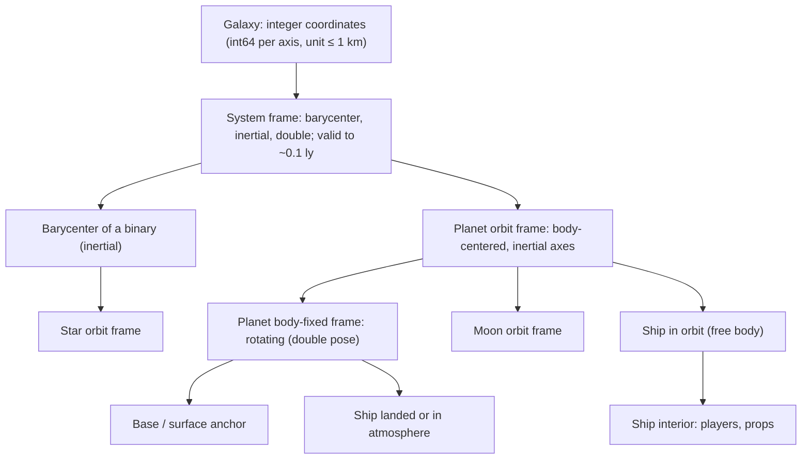

# 01: Large-world coordinates and reference frames

How positions are represented and how they flow through Veach, from a cave edit to the far side of the galaxy, at
every creator scale s. It answers Q1 of the research phase and the Q1 items of [00-scope.md](00-scope.md). Raw
notes, every source and every computed number: [notes/01-coordinates-notes.md](notes/01-coordinates-notes.md).
Numbers marked *(computed)* are IEEE 754 arithmetic done for this document; claims marked *(unverified)* were not
confirmed from a primary source.

**Short answer.** Positions are **doubles relative to a parent reference frame**. Frames are entities and form a
tree (system barycenter → body orbit frame → rotating body → base or ship → ship interior). A star system is the
largest continuous frame. Galaxy positions are **integers**. The GPU sees **only float32, camera-relative**
positions, computed in double on the CPU during extraction. There is **no floating origin** in simulation. Luau
gets a double `Position` type next to the float32 `vector`, which stays for offsets and directions. The design
is detailed in [section 7](#7-recommendation-and-what-would-change-my-mind).

## 1. The problem in Veach's terms

Everything that holds a position today is float32 and assumes one flat world:

- `Transform.translation` is `math::vec3` and `GlobalTransform` a float32 `mat4` in world space
  (`engine/ecs/include/veach/ecs/transform.hpp`). Propagation runs once per fixed step and again before extraction
  ([ADR 0018](../adr/0018-engine-lifecycle-and-phases.md)).
- Extraction copies `GlobalTransform` into `RenderView.view` and `MeshDraw.world` as is
  (`engine/render/src/renderer.cpp`), so shaders work in absolute world space. Photo mode's TLAS takes the same
  world matrices ([ADR 0041](../adr/0041-photo-mode.md)).
- The sky takes altitude from world Y and zenith as world +Y (`atmosphere.cpp:220`); `math::world_up` is a constant
  ([ADR 0013](../adr/0013-conventions-and-math.md)).
- Luau's `vector` is float32 ([ADR 0013](../adr/0013-conventions-and-math.md)), and the marshaller loads `i64`/`u64`
  fields through `double` (`engine/script/src/marshal.cpp`), so 64-bit ids above 2^53 are rounded silently. JSON
  clients in JavaScript (MCP inspectors) lose the same integers.

Float32 stops being good enough at about 16 km from its origin (1 mm steps) *(computed)*. The toolbox needs:

- **Centimeter-to-millimeter work everywhere:** edit brushes, building snaps, physics contacts, walking inside a ship
  that is in orbit.
- **Rotating, orbiting bodies:** a base sits still on a planet that spins at 465 m/s at the equator (s = 1) and
  orbits its star at ~30 km/s, while a ship in orbit next to it moves at 7.7 km/s in a different frame.
- **The full scale range** with the same code: s = 0.01 (Earth radius 63.7 km) to s = 1 (6,371 km; gas giants
  70,000 km; orbits ~10^11-10^13 m), and a galaxy ~10^21 m across.
- **Determinism** ([ADR 0018](../adr/0018-engine-lifecycle-and-phases.md)): the same seed, input and tick give the
  same state on Apple silicon and Windows x64 (Q12), with record/replay hashing the result.
- **Inspection:** positions readable and writable over MCP, in JSON scenes and saves, and from strict Luau, without
  silent precision loss.
- **No fp64 on the GPU:** Metal has no double type and Apple GPUs no fp64 hardware
  ([Apple forums](https://developer.apple.com/forums/thread/709663),
  [MSL spec](https://developer.apple.com/metal/Metal-Shading-Language-Specification.pdf)).

### The precision budget

ULP (the spacing between adjacent representable values; rounding error is up to half of it), in meters, measured
from the frame origin *(computed)*:

| Where | Distance at s = 1 | float32 | float64 | Distance at s = 0.01 | float32 | float64 |
|---|---|---|---|---|---|---|
| Base or cave, inside a local frame | 1 km | 6e-5 | 1e-13 | 1 km | 6e-5 | 1e-13 |
| Surface, from the body center | 6.37e6 | **0.5** | 9e-10 | 6.37e4 | 4e-3 | 7e-12 |
| Gas giant cloud tops | 7.0e7 | **8** | 1.5e-8 | 7.0e5 | 0.06 | 1e-10 |
| Low orbit / moon orbit | 3.8e8 (Moon) | **32** | 6e-8 | 3.8e6 | 0.25 | 5e-10 |
| Between bodies, 1 AU from the barycenter | 1.5e11 | **16 km** | 3e-5 | 1.5e9 | 128 | 2.4e-7 |
| System edge, 30 AU | 4.5e12 | **524 km** | 1e-3 | 4.5e10 | 4 km | 7.6e-6 |
| 1 light-year | 9.5e15 | 1e9 | **2** | — | — | — |
| Across the galaxy, 50,000 ly | 4.7e20 | 3.5e13 | **65 km** | — | — | — |

(Interstellar distances don't follow s; 00-scope recommends a separate, default-1 galactic factor.)

Two more sources of error matter as much as position storage *(computed)*:

- **Rotation.** A body's spin stored as a float32 quaternion misplaces a point on its surface by ~0.38 m at s = 1
  (3.8 mm at s = 0.01) every time something converts between the rotating frame and its parent. In double it's
  7e-10 m. Frame orientations must be double.
- **Time.** Orbital positions computed from `t` in double seconds lose 0.11 mm after a year, 14 mm after a century
  and 1.8 m after 10,000 years at Earth's orbital speed. Q2's integer tick clock with phase from `tick mod period`
  avoids that.

And one source of error is a non-problem: **camera-relative float32 is always sub-pixel.** A pixel at 1080p with a
60° vertical field of view covers 1.07e-3 × the distance; float32's relative step is 1.2e-7, about 1/9,000 of a
pixel at any distance *(computed)*. What breaks rendering is computing the camera-relative value in float32 from
large absolute numbers, not the float32 value itself.

**What jitter appears where, with float32 world positions today:** visible vertex wobble and z-fighting beyond
~10-20 km from the origin; at s = 1 a player on the surface of a planet-centered world snaps in 0.5 m steps and a
base 0.25 m off; physics contacts fail long before that (Jolt says float is fine within "roughly 5 km",
[Jolt docs](https://jrouwe.github.io/JoltPhysics/index.html)). At s = 0.01 the surface is borderline (2 mm rounding),
which is why a compressed-scale prototype can look fine and then fall apart at real scale.

## 2. Options, with precedents

**A. Float32 world plus a floating origin.** Positions stay float; when the player gets far from the origin, the
whole world shifts so the player is back near zero. *Precedent:* KSP's `FloatingOrigin` keeps an offset, shifts
world-space particle systems and keeps a terrain shader offset aligned
([KSP API](https://kspmoddinglibs.github.io/KSPDocsSite/class_floating_origin.html)); Unity projects generally
(HDRP's camera-relative rendering handles the render side only,
[Unity HDRP](https://docs.unity3d.com/Packages/com.unity.render-pipelines.high-definition@14.0/manual/Camera-Relative-Rendering.html));
Outer Wilds, whose creative director says the game "lost its mind" far from the sun because "floating point errors
build up" ([PC Gamer](https://www.pcgamer.com/how-to-build-a-black-hole/)); the shifting itself is reported only by
fans *(unverified)*.

**B. A plus a velocity frame and a scaled space.** KSP's Krakensbane moves the reference velocity with the active
vessel so fast-moving physics stays near rest, and coordinates with the floating origin on when a shift is safe
([KSP API](https://kspmoddinglibs.github.io/KSPDocsSite/class_floating_origin.html),
[KSP wiki](https://wiki.kerbalspaceprogram.com/wiki/Kraken)); distant planets live in a separate ScaledSpace layer
([forum](https://forum.kerbalspaceprogram.com/topic/33402-planets-and-scaledspace/page/2)). KSP2 reportedly added a
local origin for surface objects *(unverified)*.

**C. Doubles everywhere on the CPU, one world frame, camera-relative on the GPU.** *Precedents:* Unreal 5 Large World
Coordinates: double core types, Chaos physics in double, WORLD_MAX 88 million km
([UE5 LWC](https://dev.epicgames.com/documentation/en-us/unreal-engine/large-world-coordinates-in-unreal-engine-5));
its rendering converts to "translated world" (camera-relative) space "as soon as possible" because floats are safe
there ([UE5 LWC rendering](https://dev.epicgames.com/documentation/unreal-engine/large-world-coordinates-rendering-in-unreal-engine-5?lang=en-US)).
Godot's `precision=double` builds, which emulate double on the GPU with float pairs
([Godot](https://docs.godotengine.org/en/stable/tutorials/physics/large_world_coordinates.html)). Space Engineers'
double position types *(unverified)*.

**D. int64 fixed-point positions.** Every position is an integer count of a fixed unit (say 1 mm). Uniform
precision, exact and platform-independent addition. A 1 mm unit covers ±0.97 ly; 15 µm covers ±941 AU
*(computed)*. *Precedent:* common in lockstep RTS and some space sims; no primary source found for a shipped
planet-scale game using it for all positions. Elite encodes **ids** (sector x, y, z, octree layer, body) in one
64-bit integer ([80.lv](https://80.lv/articles/generating-the-universe-in-elite-dangerous/)), which is a different
thing.

**E. Sector or tile plus float offset.** A position is an integer cell plus a float offset inside it. *Precedents:*
Unreal's pre-5.4 FLWC types (`Tile * TileSize + Offset`, tile 256k), retired because "oscillating precision as
objects moved through the world" showed as jitter near tile edges and replaced with double-float pairs
([UE5 LWC rendering](https://dev.epicgames.com/documentation/unreal-engine/large-world-coordinates-rendering-in-unreal-engine-5?lang=en-US));
Niagara still splits large worlds into grid cells
([UE5 LWC](https://dev.epicgames.com/documentation/en-us/unreal-engine/large-world-coordinates-in-unreal-engine-5));
Elite's sector ids at galaxy level ([80.lv](https://80.lv/articles/generating-the-universe-in-elite-dangerous/)).

**F. A frame tree with double local positions (hybrid).** Positions are doubles relative to a parent frame; frames
are nested (system, body, rotating body, ship, interior); the galaxy level is integer; the GPU is camera-relative
float. *Precedents:* Star Citizen's "64-bit positional space" with zone containers and a local physics grid per ship
and station ("people can move around the ship regardless of where the ship is in space")
([Gamers Nexus](https://gamersnexus.net/gg/2622-star-citizen-sean-tracy-64bit-engine-tech-edge-blending),
[Gamers Nexus](https://gamersnexus.net/gg/2119-chris-roberts-star-citizen-network-and-render-pipelines),
[OCS wiki](https://starcitizen.tools/Object_Container_Streaming), press and fan sources); Elite's positions
relative to each planet's center and its doubles and dual-floats
([80.lv](https://80.lv/articles/generating-the-universe-in-elite-dangerous/)); Jolt's base-offset queries
([Jolt docs](https://jrouwe.github.io/JoltPhysics/index.html)).

## 3. Tradeoffs

| | A float + floating origin | B A + Krakensbane + scaled space | C doubles, one frame | D int64 fixed | E sector + float | **F frame tree, doubles** |
|---|---|---|---|---|---|---|
| Complexity | Low at first, then high: every system must react to shifts (particles, caches, physics, network) | High: three coupled mechanisms, KSP's notorious bug source | Medium: wide type change, one mechanism | High: conversions at every math call (rotation, physics, noise all need float/double) | Medium; cell crossings everywhere | Medium-high: type change plus frames, but frames are needed anyway for rotating bodies and ship interiors |
| CPU cost | Lowest | Low | Doubles: 2-wide NEON vs 4-wide float, scalar about the same | Integer add cheap, everything else converts | Low | Same as C; propagation stops at frames |
| GPU cost | Float | Float | Float if camera-relative on CPU; double-float if absolute on GPU (Unreal: "substantial performance cost") | Float after conversion | Float | Float, camera-relative computed on the CPU |
| Determinism | **Bad:** results depend on where the origin is, which depends on where the player is; no single origin with players in several places | Bad, same reason | Good with Q12's rules (no FMA contraction, engine trig) | Best for storage; arithmetic outside add/sub still float | Good | Good, as C; nothing depends on the camera |
| Extensibility | New systems must hook origin shifts | Worse | Good: one type | Poor: every module does conversions | Medium | Good: new frame kinds are entities with a pose provider |
| Testability, MCP | Positions change meaning when the origin moves; replays need the shift history | Worse | Good: positions mean the same in every run | Good, but unreadable (integers in mm) | Medium | Good: positions are stable per frame, frame paths are readable |
| Scale range | Breaks at s = 1 without many re-origins; per-body frames needed anyway | Works (KSP is 1/10 scale) | Works within ~0.1 ly of the origin (0.25 m ULP); **not** galaxy-wide | ±0.97 ly at 1 mm: not galaxy-wide either | Unlimited | Unlimited: doubles per system, integers above |
| Rotating bodies | Must be added | Must be added | Must be added (one frame can't hold a spinning base still) | Must be added | Must be added | Built in |

The deciding points: A and B tie simulation results to the camera, which breaks determinism and multiplayer; C alone
can't hold a galaxy and still needs rotating frames; D pays conversion costs everywhere for a property (exact
addition) we only need in ids and saves; E's cell crossings recreate Unreal's tile jitter. F is C plus the frames the
toolbox needs anyway, with integers only where doubles run out.

## 4. Extension points

| What plugs in | Luau | C++ module | Toolbox core / engine only |
|---|---|---|---|
| A new frame (station, carrier, moving platform) | Yes: an entity with `ReferenceFrame`, pose written by a script system | Yes | — |
| A pose provider (Kepler orbits, n-body, Lagrange points, scripted paths) | Simple ones (scripted path from the tick) | Yes: Q2's orbit module is one | — |
| A handoff policy (SOI, altitude bands, docking) | Parameters (radii, hysteresis) | Yes: the policy | The re-parenting mechanism with pose and velocity conversion: engine |
| A frame-aware physics world | — | Yes (Q9) | — |
| Up and gravity at a position | Read | Gravity sources (Q10) | The `up` query: engine |
| Position types, propagation, camera-relative extraction, `Position` in Luau, int64 marshalling | — | — | Engine (generic per [ADR 0042](../adr/0042-space-toolbox-layering.md)) |
| Galaxy integer coordinates, body frame kinds (orbit and body-fixed) | — | — | Toolbox core (`space/`) |

## 5. Interactions with the other questions

- **Q2 mechanics and time:** owns the pose providers. Orbit and spin poses come from the integer tick (`tick mod
  period`) in double with deterministic math; 00-scope's time-precision note is confirmed here (1.8 m drift after
  10,000 years from double seconds). Q2 picks the system's reference plane, the SOI rule, and the spin limit below
  breakup.
- **Q3 generation:** galaxy ids double as galaxy integer coordinates; frame ids for bodies come from Q3's ids. The
  pipeline runs in physical units, and s is applied when building frame poses and geometry.
- **Q4 terrain:** chunks are positioned in the body-fixed frame; vertices are chunk-relative float32; chunk sizes stay
  in the few-km range for mm precision at any s. GPU meshing and noise must not use body-centered float32 at s = 1.
- **Q5 procgen graph:** generators get body-relative double positions on the CPU and a split-double origin on the
  GPU. Output that gameplay depends on comes from the deterministic path (Q12).
- **Q6 networking:** positions on the wire are (frame id, frame-local, quantized). No floating origin means the
  server and clients agree on positions without exchanging origins. Interest management can group by frame.
- **Q7 simulation LOD:** off-screen entities stay in their frame; catch-up moves frames by the tick, not entities.
- **Q8 renderer:** inherits camera-relative `RenderWorld`, the per-view body context (altitude, up, body-relative
  camera), the jitter risks listed above, and the far-body question. N suns come as directions in the camera's frame.
- **Q9 physics:** one physics world per active frame; never system coordinates; double mode or a base offset; the
  fictitious-force flag.
- **Q10 gravity, flight and travel:** owns the handoff policy with Q2, the `up` model and the speeds that decide how
  often handoffs and chunk re-basing happen (128 m per tick in low orbit at s = 1, 12.8 m at s = 0.01 *(computed)*).
- **Q11 persistence:** saves store (frame id, local position) and body-local chunk keys; the manifest records s.
  Recordings record the manifest.
- **Q12 numeric determinism:** this design depends on its rules for double arithmetic (FMA contraction, engine trig)
  on Clang ARM64 and MSVC x64.

## 6. M1-class vs M3 Pro-class

- **GPU:** neither has fp64, so the recommended design runs the same shaders on both, all float32. The difference
  appears only where something emulates double on the GPU (body-relative noise in Q4, Q5 and Q8). Double-float
  arithmetic takes several float operations per add or multiply, and Unreal calls its cost "substantial"
  ([UE5 LWC rendering](https://dev.epicgames.com/documentation/unreal-engine/large-world-coordinates-rendering-in-unreal-engine-5?lang=en-US));
  no measured numbers exist for Apple GPUs. Keep it per chunk or per vertex, not per pixel per noise octave. That
  rule matters more on M1-class, which has fewer GPU cores.
- **CPU:** double math has about the same scalar latency as float on both, and half the SIMD width (2 vs 4 lanes in
  128-bit NEON). The extra cost lands in propagation, frame composition and extraction, and scales with entity count,
  not with the GPU. Uploading camera-relative matrices (288 MB/s for 100k instances) is small next to either chip's
  unified memory bandwidth.
- **Windows/MSVC:** doubles are SSE2 on x64; the risk is determinism (Q12), not speed.
- **The owner's hardware-target call doesn't depend on Q1.** Coordinates cost CPU time in proportion to entity
  count, which Q7's simulation LOD bounds.

## 7. Recommendation, and what would change my mind

**Adopt F:** double positions relative to a frame tree of entities, integer galaxy coordinates, float32
camera-relative rendering computed in extraction, no floating origin in simulation, and a double `Position` type in
Luau next to the float32 `vector`. The engine owns the generic parts (types, frames as entities, propagation,
handoff mechanism, camera-relative extraction, Luau and JSON types); `space/` owns the galaxy integers, body frame
kinds and the handoff policy.

### The design in detail

#### The frame tree

- **A frame is an entity** with a `ReferenceFrame` component: kind (inertial or rotating), and a **double pose
  relative to its parent frame** (position `dvec3`, orientation `dquat`, plus linear and angular velocity so handoffs
  can convert velocity). A **pose provider** writes it: Q2's orbit module for orbit and body frames (from the integer
  tick), gameplay for ships and stations.
- **An ordinary entity lives in one frame:** its nearest frame ancestor in the `ChildOf` hierarchy.
- **Inertial vs rotating:** each body has an orbit frame (centered on the body, axes fixed to the system) and a
  body-fixed frame (rotating with the body). Bases, terrain, landed ships and walking players live in the body-fixed
  frame, where they stand still. Ships in orbit live in the orbit frame, where Kepler motion is simple.
- **The system frame is the root of continuous space.** Its axes are fixed (Q2 picks the reference plane). Doubles
  give 30 µm at 1 AU and 1 mm at 59 AU *(computed)*: enough for everything near a system, and nothing precise
  happens far from a body anyway, because entities sit in body frames.
- **The galaxy level is integers.** Each system has an integer galaxy position (int64 per axis; a 1 km unit covers
  ±975,000 ly *(computed)*); Q3's octree sector id can encode it. Directions and distances between systems (starfield,
  deep-sky objects, FTL targeting) come from exact integer differences converted to double. Nothing simulates between
  systems: interstellar travel is FTL (00-scope), and a system frame stays usable to ~0.1 ly (0.25 m ULP) for
  creators who want slower travel near the edges.

#### Components and propagation

- `Transform.translation` becomes **`dvec3`**, for every entity; `rotation` stays a float32 `quat` and `scale` a
  float32 `vec3` (local orientations of props and players don't need more). Frame entities keep their precise pose in
  `ReferenceFrame` (double orientation), because a float32 spin costs 0.38 m at the surface at s = 1.
- **Propagation stops at frames.** The world-space `GlobalTransform` is replaced by a **frame-relative** transform
  (double translation, float32 3×3 basis): the pose of the entity in its frame. I recommend renaming it
  (`FrameTransform`), so every existing use of "world space" is reviewed rather than silently reinterpreted.
- Frame-to-frame poses are composed in double through the **lowest common ancestor**, cached once per tick. Two
  entities in the same body-fixed frame compare at nanometer precision without ever touching system coordinates.
- `world_up` stays valid only inside flat frames. "Up" becomes a query: `up(frame, position)` returns the gravity or
  body normal direction (Q10 owns the gravity model).
- Timing: pose providers run in Simulation (from the tick), gameplay writes Transforms in Simulation, and
  TransformPropagation then resolves frame-relative transforms and frame poses, as today.

#### Frame handoff

An entity changes frame by re-parenting, which converts its pose and velocity in double: for a rotating frame,
`v_rot = v_inertial − ω × r`. That term is 465 m/s at Earth's equator at s = 1 and 4.6 m/s at s = 0.01
*(computed)*, so skipping it is a visible jolt. Handoff rules (sphere of influence between bodies; an altitude band
between a body's orbit frame and its body-fixed frame) need hysteresis so an entity on the boundary doesn't flap.
The mechanism (re-parent with conversion) is engine; the policy (when to switch) is a toolbox module, owned by Q2 and
Q10.

#### Fictitious forces

Physics in a rotating frame ignores Coriolis and centrifugal terms by default, as 00-scope recommends. That is safe
for Earth-like days at any scale (centrifugal 0.35 % of g at s = 1, Coriolis 0.015 m/s² at 100 m/s) and visibly wrong
for short days on small bodies: a 30-minute day at s = 0.01 gives 7.9 % of g outward at the equator and Coriolis of
7 % of g on a 100 m/s projectile; at s = 1 the same day is beyond breakup *(computed)*. Make it a per-body flag that a
physics module can honor (Q9), and have Q2/Q3 reject spins above breakup (ω²R ≥ g).

#### Simulation, physics, networking

- **Simulation** runs in frame-local doubles. No floating origin: nothing in simulation depends on where the camera
  or any player is, so results are the same on the server, on every client and in a replay.
- **Physics (Q9)** runs one physics world (or region) per active frame that has moving bodies: a planet's body-fixed
  frame near players, each ship interior. It never sees system coordinates. Jolt's double mode keeps positions in
  double, is 5-10 % slower than float, and its broad phase has 1 m resolution 10,000 km from the origin
  ([Jolt docs](https://jrouwe.github.io/JoltPhysics/index.html)), which covers a body-fixed frame at s = 1; a float
  build with a per-region base offset also works. Q9 decides.
- **Velocities** stay float32 (4.9e-4 m/s ULP at 7.7 km/s *(computed)*); Krakensbane-style velocity frames aren't
  needed when positions are double, except where co-moving bodies at high speed share a physics world, which a ship
  frame already solves.
- **Networking and saves (Q6, Q11)** carry (frame id, frame-local position), never system or galaxy doubles, and
  quantize relative to the frame (or to a nearby chunk) on the wire. Frame ids come from Q3's stable ids. Edits and
  surface anchors use body-local chunk keys in meters (Q4, Q11). The universe manifest records s; changing s after
  edits exist is not supported (00-scope).

#### Rendering

- **Extraction makes everything camera-relative.** The render origin is the camera's position, with the axes of the
  camera's frame. For each draw, light and view, extraction computes `camera_from_object` in double through the frame
  tree and casts it to float32. `RenderWorld` holds **no absolute positions**. This is Unity HDRP's camera-relative
  rendering and Unreal's translated world space, done fully on the CPU, so shaders never need double-float.
- **Per-frame cost:** re-uploading camera-relative matrices for 100k instances is 4.8 MB per frame (288 MB/s at
  60 fps) *(computed)*. For GPU-driven content (terrain chunks, vegetation) only the chunk origins are re-based each
  frame; vertices and instances stay chunk-relative float32, and chunks stay small (a few km, mm precision).
- **Per-view body context** for the sky, terrain and fog: altitude and up computed in double on the CPU (replacing
  `view.position.y`), the camera's position relative to the nearest body as a double split into two floats (high and
  low) for GPU procedural noise, and the frame's rotation for sun directions.
- **Where jitter can still appear** with this design, and who owns it: GPU noise evaluated at body-relative positions
  in float32 (0.5 m steps at s = 1: swimming textures, stair-stepped terrain detail), which Q4/Q5/Q8 must evaluate in
  chunk-local or double-float coordinates (Elite uses "dual-float" for exactly this,
  [80.lv](https://80.lv/articles/generating-the-universe-in-elite-dangerous/)); shadow cascades, which must snap
  texels in a stable frame, not camera space (Q8); and motion vectors or render interpolation, which need the
  previous frame's camera delta in double (Q8; `FixedTimestep::alpha` is unused today).
- **Render graph:** unchanged. Passes and barriers don't care about coordinates.
- **Photo mode:** the TLAS takes camera-relative instance transforms, fixed at the camera position where accumulation
  starts. Accumulation already restarts when the view changes, so nothing else changes.
- **Far bodies:** camera-relative float32 handles any distance (sub-pixel), and reverse-Z with an infinite far plane
  handles depth ([ADR 0013](../adr/0013-conventions-and-math.md)). Whether distant bodies need a separate pass (KSP's
  ScaledSpace) is a Q8 question about LOD and depth ordering, not about position precision.

#### Luau, JSON, MCP, record/replay

- **Luau:** a new **`Position`** type: userdata holding three doubles (Luau numbers are doubles), with `x`, `y`, `z`,
  `Position + vector → Position` and `Position − Position → vector`. `Transform.translation` becomes a `Position`.
  `vector` stays float32 for what it's good at: offsets, directions, velocities, local shapes. A float32 difference
  keeps its relative precision, so `a − b` between far points is still a correct direction and distance; scripts that
  move things long distances do it with `Position` arithmetic. Frame API in `@veach`: the entity's frame, converting a
  position between frames, the offset between two entities as a `vector` (computed in double through the common
  ancestor), and `up` at a position. Generated types (`types/veach.d.luau`) get `Position`.
- **64-bit integers** never cross Luau or JSON as numbers: ids are tagged userdata in Luau (entities already are) and
  strings in JSON and MCP. The marshaller's `i64`/`u64` → `double` path becomes an error for values above 2^53, then
  goes away once ids have their own type.
- **JSON, scenes, schemas:** a `dvec3` is `[x, y, z]` with round-trip double formatting; a position always names its
  frame (an entity path). Schemas from reflection mark int64 fields as strings.
- **MCP:** `get_component` and `set_component` take frame-relative positions; a `frames` view (the tree with each
  frame's pose and kind) helps agents. Doubles are exact in JavaScript.
- **Record/replay:** hashes include double fields; the header adds the universe manifest (seed, s, generator
  versions: Q11). Replays only hold across platforms if Q12's arithmetic rules hold.

#### Determinism

Double +, −, ×, ÷ and √ are exactly reproducible on ARM64 and x64 if the compiler doesn't contract a·b + c into an
FMA and the code doesn't call platform `sin`/`cos`/`atan2`. Clang on ARM64 and MSVC on x64 differ there by default
*(unverified defaults)*; Jolt asks for `-ffp-contract=off` and its own trig functions for cross-platform determinism,
at about 8 % cost ([Jolt docs](https://jrouwe.github.io/JoltPhysics/index.html)). Frame poses from orbits and spins
are trig of the tick, so they must use Q12's engine math. Nothing in this design depends on the camera, so
determinism is a property of the math, not of who is watching.

### What would change my mind

- **Luau `Position` costs too much** (spike S1.3): if userdata arithmetic is too slow for gameplay scripts, keep
  `Transform.translation` double in C++ but expose positions to Luau as frame-local `vector`s, with an error (not
  silent rounding) when a value is beyond float32's safe range for its frame.
- **Double propagation or extraction is measurably expensive** at Q7's entity counts (spike S1.1): keep double only
  on frame roots and float32 for children within small local frames (Star Citizen's grids), at the cost of more frame
  bookkeeping.
- **Q6 picks lockstep with bit-exact physics across platforms** and Q12 shows doubles can't be made reproducible
  cheaply: store authoritative positions as int64 fixed point (option D) inside frames, converting to double for math.
  The frame tree stays.
- **The product wants continuous sublight flight between stars:** a galaxy-level frame of integer sectors with a
  double offset inside each sector, with handoff between sectors (option E at the top level only).

## 8. What is expensive to undo

- **The type of `Transform.translation` and its Luau type.** Every script, scene, schema, save and MCP client
  depends on it. Cheap now (a few lab scripts), expensive after any toolbox code or user content exists.
- **"Positions are frame-relative" in saves and on the wire.** A save format with absolute or scaled positions can't
  be migrated without the generator that made them.
- **Camera-relative `RenderWorld`.** Every shader written after this assumes it. Cheap to adopt now with a handful of
  shaders; a rewrite later.
- **Frame identity.** Frame ids key saves, network messages and edits; they must come from Q3's stable ids from the
  start.
- **No floating origin.** Adding one later is possible for rendering only; adding it to simulation later would break
  the determinism contract and every recording.

## 9. Proposed ADRs (engineering decisions)

1. **Large-world positions: doubles relative to a reference frame; float32 only on the GPU.** Supersedes the
   coordinate parts of [ADR 0013](../adr/0013-conventions-and-math.md) (`Transform` type, `world_up` as a constant).
2. **Reference frames are entities with double poses; propagation stops at frames.** Frame kinds, lowest-common-
   ancestor composition, the renamed frame-relative transform, re-parenting with pose and velocity conversion.
3. **No floating origin: simulation never depends on the camera or on players' positions.**
4. **Camera-relative extraction: `RenderWorld` holds no absolute positions.** Extends
   [ADR 0020](../adr/0020-renderer-data-and-extraction.md); covers per-view body context and the photo-mode TLAS
   ([ADR 0041](../adr/0041-photo-mode.md)).
5. **Luau gets a double `Position` type; `vector` stays float32 for offsets and directions.**
6. **64-bit integers cross Luau, JSON and MCP as tagged userdata or strings, never as numbers.**
7. **Galaxy coordinates are integers; a star system is the largest continuous double frame** (toolbox).
8. **Frame handoff policy: sphere of influence and altitude bands with hysteresis** (toolbox, with Q2 and Q10).

## 10. Spike candidates

Each is a throwaway prototype on a branch, sized by what it touches.

- **S1.1 Precision ladder.** *Scope:* `Transform.translation` as `dvec3`, propagation in double, camera-relative
  extraction in the views and scene extractors; one lab script. A lit cube 1 m in front of the camera, with camera and
  cube placed together at 1 km, 64 km, 6,371 km, 1 AU and 30 AU from the origin, rendered headless with the old path
  and the new one. *Success:* new path, every distance compared with the at-origin image by `veach imgdiff` shows no
  difference (FLIP at the noise floor); old path visibly breaks from ~100 km on (the screenshot grid is the
  evidence). Tracy: propagation and extraction zones with 100k entities, float vs double, on the M5 Max.
- **S1.2 Rotating planet and handoff.** *Scope:* `ReferenceFrame` entities (system → planet orbit frame →
  body-fixed frame), a Luau pose provider spinning and orbiting the planet from the tick, a base cube in the body
  frame, a camera ship moving from the orbit frame into the body frame through one handoff. Run at s = 1 and
  s = 0.01 from one config switch. *Success:* screenshots every 60 frames show the base fixed relative to the terrain
  marker and no jump at the handoff frame; the log shows velocity continuity |Δv| < 1 mm/s across the handoff and the
  base's body-frame position unchanged to 1e-9 m after 10^5 ticks.
- **S1.3 Luau `Position` cost.** *Scope:* a `Position` userdata with arithmetic metamethods, and a benchmark script
  system doing N `Position` and N `vector` operations per tick. *Success:* a Tracy zone per variant; the number of
  `Position` operations that fit in 0.5 ms on the M5 Max, scaled to an M1-class estimate; decide between the design
  above and the fallback in section 7.
- **S1.4 Body-relative GPU noise at real scale** (shared with Q4/Q5). *Scope:* a compute pass shading a surface
  patch at 6,371 km from the body center with fractal noise, once with float32 body-relative coordinates and once
  with a split-double origin. *Success:* the float32 image shows stair-stepping or swimming as the camera moves 1 cm
  per frame, the split version doesn't (side-by-side screenshots); Tracy GPU time of both on the M5 Max.

## 11. Product decisions for the owner

1. **Is space between stars continuous?** *Recommendation:* no. Travel between systems is an FTL transition, and each
   system is continuous to ~0.1 ly. Continuous sublight interstellar flight would add a sector frame level and
   handoffs between sectors.
2. **Largest supported galaxy.** *Recommendation:* up to ~1 million light-years across (int64 kilometers), default a
   Milky Way-like 100,000 ly. Bigger is possible with a coarser unit, at no cost to anything near a player.
3. **Fictitious forces on rotating bodies.** *Recommendation:* off by default for every body; a per-body creator flag
   for games that want Coriolis and centrifugal effects (noticeable only on short-day, small planets), and a hard
   limit that rejects spins above breakup.
4. **Scale is fixed once a universe has saves or edits** (confirming 00-scope). *Recommendation:* yes; saves store
   frame-local meters at the universe's s and the manifest records s.

## Sources

Engines and libraries:

- Unreal Engine 5, Large World Coordinates: https://dev.epicgames.com/documentation/en-us/unreal-engine/large-world-coordinates-in-unreal-engine-5
- Unreal Engine 5, LWC Rendering: https://dev.epicgames.com/documentation/unreal-engine/large-world-coordinates-rendering-in-unreal-engine-5?lang=en-US
- Unreal forum, LWC jitter and tile size (anecdotal): https://forums.unrealengine.com/t/lwc-large-world-coordinates-do-not-work-for-first-person-shooters-driving-games-wobbly-rendering-artefacts-ue5-only-ue4-works-fine/652748/19
- Unity HDRP, Camera-relative rendering: https://docs.unity3d.com/Packages/com.unity.render-pipelines.high-definition@14.0/manual/Camera-Relative-Rendering.html
- Godot, Large world coordinates: https://docs.godotengine.org/en/stable/tutorials/physics/large_world_coordinates.html
- Jolt Physics documentation (Big Worlds, Deterministic Simulation): https://jrouwe.github.io/JoltPhysics/index.html
- Metal Shading Language specification: https://developer.apple.com/metal/Metal-Shading-Language-Specification.pdf
- Apple Developer Forums, FP64 on Metal: https://developer.apple.com/forums/thread/709663
- W3C public-gpu list, fp64 on Metal: https://lists.w3.org/Archives/Public/public-gpu/2022Apr/0006.html
- FP64 emulation on Apple GPUs (P. Turner): https://gist.github.com/philipturner/0d47f5e925bb3a9568d3c4d6dca19a1b

Games:

- KSP API, FloatingOrigin and Krakensbane: https://kspmoddinglibs.github.io/KSPDocsSite/class_floating_origin.html
- KSP wiki, Kraken: https://wiki.kerbalspaceprogram.com/wiki/Kraken
- KSP forum, ScaledSpace: https://forum.kerbalspaceprogram.com/topic/33402-planets-and-scaledspace/page/2
- KSP2 developer diaries (local origin claim, unverified): https://kerbalspaceprogram.com/news/dev-diaries-developer-insights-10-collisions
- Star Citizen, Sean Tracy on 64-bit positions: https://gamersnexus.net/gg/2622-star-citizen-sean-tracy-64bit-engine-tech-edge-blending
- Star Citizen, Chris Roberts on network and render pipelines (zones, physics grids): https://gamersnexus.net/gg/2119-chris-roberts-star-citizen-network-and-render-pipelines
- Star Citizen, Object Container Streaming (fan wiki): https://starcitizen.tools/Object_Container_Streaming
- Elite Dangerous, Stellar Forge (80.lv): https://80.lv/articles/generating-the-universe-in-elite-dangerous/
- Outer Wilds, Alex Beachum (PC Gamer): https://www.pcgamer.com/how-to-build-a-black-hole/

Not consulted, listed for follow-up: Thatcher Ulrich, "Rendering Massive Terrains using Chunked Level of Detail
Control" (SIGGRAPH 2002); SpaceEngine's internals; Space Engineers' VRageMath types; CitizenCon talks.

Repository: [ADR 0003](../adr/0003-platforms-and-hardware-target.md), [0013](../adr/0013-conventions-and-math.md),
[0018](../adr/0018-engine-lifecycle-and-phases.md), [0020](../adr/0020-renderer-data-and-extraction.md),
[0029](../adr/0029-render-graph-sync-and-barriers.md), [0030](../adr/0030-frame-and-sync-model.md),
[0040](../adr/0040-interim-realtime-path-visibility-buffer.md), [0041](../adr/0041-photo-mode.md),
[0042](../adr/0042-space-toolbox-layering.md); `engine/ecs/include/veach/ecs/transform.hpp`,
`engine/render/src/renderer.cpp`, `engine/render/src/atmosphere.cpp`, `engine/render/src/scene_renderer.cpp`,
`engine/script/src/marshal.cpp`; [record-replay spec](../specs/record-replay/spec.md).
