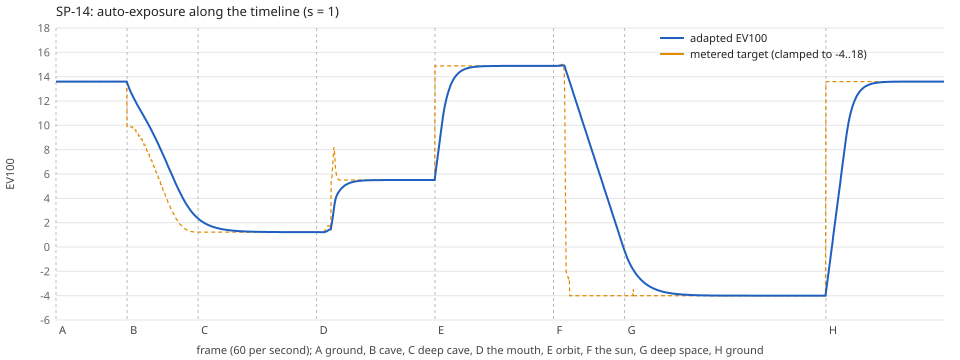

# SP-14: exposure and depth from a cockpit to deep space (VCH-090)

Validates the depth and exposure parts of [ADR 0063](../../adr/0063-astronomical-rendering.md) (reverse-Z float32 with
an infinite far plane and camera-relative positions; histogram auto-exposure that stays on the GPU, with pre-exposure),
on the interim raster path ([ADR 0040](../../adr/0040-interim-realtime-path-visibility-buffer.md)) and SP-10's planet
sky ([findings](sp-10-atmosphere.md), [ADR 0076](../../adr/0076-amendments-from-sp-10.md)). Research:
[08-renderer](../08-renderer.md) §2.9, §2.10, spikes S5 and S7. Apple M5 Max, Metal, 2026-11-27.

**Verdict.**

- **Depth holds, with no far-body pass and no depth partition.** A cockpit 0.1 to 2 m away, a moon at 3.84e8 m and a
  gas giant at 7e8 m (and a second moon at 9.5e8 m behind its limb) are rasterized into one depth buffer with a
  0.05 m near plane, at s = 1 and s = 0.01, without fighting. Float32 reverse-Z resolves about 1e-7 of the distance
  at every distance (11 m at 1e8 m, as 0063 says; 41 m at the moon), which is 10,000 times finer than a 1080p pixel's
  footprint. Measured on the GPU: two parallel surfaces stop fighting once they are 2.6e-7 of their distance apart,
  at both scales.
- **The limit is float32 positions, not the depth format.** Reverse-Z depth is exactly as precise as a float32
  camera-relative position; camera-relative extraction is what makes it work. With float32 world positions (today's
  `Transform`), the cockpit disappears 1e8 m from the origin and jumps in 6 cm steps 1e6 m from it.
- **Auto-exposure holds.** Sunlit ground (EV100 13.6), a headlamp-lit cave (1.2), orbit over the limb (14.9) and deep
  space with only stars (-4, the range's floor) each adapt to an unclipped frame: 0% of pixels white or crushed once
  adapted, apart from black space itself and the cave's opening seen from inside (below). It adapts 9 stops brighter in
  1.05 s and 17 stops in 1.6 s, 3.7 stops darker in 1.35 s. It costs 0.05 ms at 1080p and never reads back to the CPU.
- **No non-finite pixels with pre-exposure,** in 2,250 frames including the sun's disk seen from orbit and from inside
  the cave. On Metal the fp16 write itself saturates at 65,504: removing the shader's explicit clamp changed nothing.
- **One frame cannot be both unclipped and readable:** looking out of the cave at sunlit ground spans 13.4 stops, more
  than AgX's 8-bit range. A global exposure clips one end whatever the metering; a decision for the owner, below.
- Neither kill criterion is met.

## What was built

| File | What |
|---|---|
| `engine/render/shaders/exposure.slang` | `exposure_histogram` (128 bins of EV100 over -8 to 24, a groupshared histogram per 16 x 16 tile, counters for non-finite, fp16-saturated and below-the-histogram pixels) and `exposure_resolve` (one group: the metered band, the highlight term, adaptation, the new exposure; clears the bins) |
| `engine/render/src/realtime_renderer.cpp` | With `RenderView::auto_exposure`: the exposure state buffer (persistent, on the GPU), the two passes between shade and display, and a copy of the state into a frame-slot readback buffer that is logged two frames later (`exposure` category) and raises `render.nonfinite_pixels` |
| `engine/render/shaders/realtime_shade.slang` | Pre-exposure: radiance times the state's exposure (last frame's) when auto-exposure is on; every write clamped to the fp16 maximum (NaN kept for the check) |
| `engine/render/shaders/display.slang` | With auto-exposure, the exposure is the adapted one over the pre-exposure |
| `engine/render/include/veach/render/renderer.hpp` | `AutoExposureSettings`, `RenderView::auto_exposure` (optional; empty = the camera's ev100, unchanged), `ResolvedSky::stars` |
| `engine/render/shaders/veach/atmosphere.slang`, `src/atmosphere.cpp` | A procedural starfield (one star or none per cube-map cell, counts from the real sky to magnitude 8, each an energy-conserving Gaussian of 0.6 px with E = 2.5e-6 lux x 10^(-0.4 m)), behind the planet's air or with no sky; `PlanetSky::ambient` scales the sky's ambient light |
| `engine/core/include/veach/core/error_codes.inl`, `docs/reference/errors.md` | `render.nonfinite_pixels` |
| `apps/lab/src/sp14_spike.cpp` | The lab module: `VEACH_SP14=depth` (cockpit, gas giant, two moons from runtime meshes, drawn camera-relative or in float32 world space) and `VEACH_SP14=exposure` (a 2,250-frame timeline on SP-10's Earth-like planet) |
| `tests/sp14_depth_tests.cpp` | `[sp14.depth]`: the engine's projection in float32 separates surfaces 3e-7 of their distance apart from 0.1 m to 1 AU |
| `docs/research/spikes/sp-14/scripts/` | `shots.py` (every screenshot and table below), `precision.py` (the depth table), `timings.py` (GPU ms over MCP), `pngio.py` |

**The seam to the engine.** With `RenderView::auto_exposure` and `ResolvedSky::stars` empty nothing changes but a
clamp that never triggers in the goldens: every deterministic golden output is byte-identical to the baseline
(photo mode's Cornell box differs between two runs of the same build, as SP-10 found). The interim renderer has no
shadows, so the cave is a stand-in: the extractor removes the sun's direct light and scales the sky's ambient light
by the camera's depth inside the chamber, and turns aerial perspective off there (see the findings).

## Depth

### Precision, computed

`precision.py`: float32, near plane 0.05 m, the depth step as the range of distances that store the same depth. The
pixel footprint is one pixel at 1080p and a 60 degree vertical field of view.

| | distance (m) | float32 position step (m) | reverse-Z depth step (m) | relative | conventional float depth step (m) | 1080p pixel footprint (m) | pixel / depth step |
|---|---|---|---|---|---|---|---|
| cockpit sensor housing | 0.1 | 7.45e-09 | 1.19e-08 | 1.2e-07 | 1.19e-08 | 0.000107 | 8.97e+03 |
| dashboard | 0.5 | 5.96e-08 | 3.73e-08 | 7.5e-08 | 2.98e-07 | 0.000535 | 1.44e+04 |
| window frame | 1 | 1.19e-07 | 7.45e-08 | 7.5e-08 | 1.19e-06 | 0.00107 | 1.44e+04 |
| cockpit wall | 2 | 2.38e-07 | 1.49e-07 | 7.5e-08 | 4.77e-06 | 0.00214 | 1.44e+04 |
| a building | 100 | 7.63e-06 | 1.16e-05 | 1.2e-07 | 0.0119 | 0.107 | 9.18e+03 |
| a mountain | 1e+04 | 0.000977 | 0.000909 | 9.1e-08 | 120 | 10.7 | 1.18e+04 |
| 100 km | 1e+05 | 0.00781 | 0.0114 | 1.1e-07 | 1.5e+04 | 107 | 9.4e+03 |
| moon at s = 0.01 | 3.84e+06 | 0.25 | 0.262 | 6.8e-08 | never | 4.11e+03 | 1.57e+04 |
| gas giant at s = 0.01 | 7e+06 | 0.5 | 0.435 | 6.2e-08 | never | 7.48e+03 | 1.72e+04 |
| ADR 0063's 1e8 m | 1e+08 | 8 | 11.1 | 1.1e-07 | never | 1.07e+05 | 9.63e+03 |
| moon | 3.84e+08 | 32 | 40.9 | 1.1e-07 | never | 4.11e+05 | 1e+04 |
| gas giant | 7e+08 | 64 | 68 | 9.7e-08 | never | 7.48e+05 | 1.1e+04 |
| far moon | 9.5e+08 | 64 | 62.6 | 6.6e-08 | never | 1.02e+06 | 1.62e+04 |
| 1 AU | 1.5e+11 | 1.64e+04 | 1.21e+04 | 8.1e-08 | never | 1.6e+08 | 1.32e+04 |

- **Reverse-Z keeps a constant relative precision**, 2^-24 to 2^-23 of the distance, because the stored depth
  near / distance is a float with the same mantissa as the distance. Its step is the same size as the step of the
  float32 position it comes from, at every distance.
- Conventional float depth (1 - near / distance) loses everything past about 1e6 m ("never": every farther distance
  stores 1.0), which is why reverse-Z is required, not preferred.
- A depth step is 9,000 to 16,000 times smaller than a pixel's footprint at every distance: geometry far enough apart
  to be seen as separate is always far enough apart in depth, except at grazing angles.

### Cockpit, moon and gas giant in one frame


*1920 x 1080, 70 degrees, EV100 15, a 1 AU sun from behind and to the right, s = 1.* A sensor housing 0.1 m from the
eye (upper left), the dashboard with two emissive displays (0.45 to 0.95 m), the window frame and its mullion (1 m),
the side wall and the nose (to 2.2 m). Through the window the gas giant (R 7e7 m at 7e8 m), the moon in front of it
(R 1.737e6 m at 3.84e8 m, the dark dot just right of the mullion, its left third behind it) and stars too faint for this exposure.

| | s = 1 | s = 0.01 |
|---|---|---|
| The mullion (1 m), the moon (3.84e8 m) and the gas giant (7e8 m), 4 degrees |  |  |
| The far moon (9.5e8 m) half behind the gas giant's limb, 2 degrees |  |  |

- Every occlusion is right and every edge clean: the mullion over the moon's night side, the moon over the giant's
  bands, the giant's limb over the far moon.
- **Scale-free:** at s = 0.01 (distances and radii times 0.01, the cockpit not) the wide view matches s = 1 to a mean
  FLIP of 0.00000 (worst pixel 0.004) ([s = 0.01](sp-14/depth/wide_s0.01.png)).
- Every depth run counted 0 non-finite pixels (`VEACH_SP14_CHECK=1` runs the exposure pass at a fixed EV).

### Where fighting starts: a shell over the moon

A red shell with the moon's own tessellation (96 x 192), drawn after the moon, delta meters above its surface: the
two surfaces are parallel, so only precision can make them fight. The moon alone, 0.8 degrees; a pixel is grey where
the moon wins the depth test inside the shell's lit disk.

| s | moon at | shell height (m) | relative to the distance | fighting pixels |
|---|---|---|---|---|
| 1 | 3.84e+08 m | 3000 | 7.8e-06 | 0.00% of 58366 |
| 1 | 3.84e+08 m | 1000 | 2.6e-06 | 0.00% |
| 1 | 3.84e+08 m | 300 | 7.8e-07 | 0.01% |
| 1 | 3.84e+08 m | 100 | 2.6e-07 | 0.03% |
| 1 | 3.84e+08 m | 30 | 7.8e-08 | 25.45% |
| 1 | 3.84e+08 m | 10 | 2.6e-08 | 70.84% |
| 1 | 3.84e+08 m | 1 | 2.6e-09 | 97.31% |
| 0.01 | 3.84e+06 m | 30 | 7.8e-06 | 0.00% of 58365 |
| 0.01 | 3.84e+06 m | 3 | 7.8e-07 | 0.01% |
| 0.01 | 3.84e+06 m | 1 | 2.6e-07 | 0.01% |
| 0.01 | 3.84e+06 m | 0.3 | 7.8e-08 | 15.67% |
| 0.01 | 3.84e+06 m | 0.1 | 2.6e-08 | 56.34% |
| 0.01 | 3.84e+06 m | 0.01 | 2.6e-09 | 92.95% |

| 100 m at s = 1 (2.6e-7) | 30 m at s = 1 (7.8e-8) | 1 m at s = 0.01 (2.6e-7) | 0.3 m at s = 0.01 (7.8e-8) |
|---|---|---|---|
|  |  |  |  |

- Fighting starts between 2.6e-7 and 7.8e-8 of the distance, the same at both scales: two to three steps of the
  table above (vertex positions and depth both round at about 1e-7).
- **The rule for layered far bodies:** surfaces drawn as separate geometry need more than about 3e-7 of their
  distance between them (more than 100 m at the moon's distance at s = 1, 1 m at s = 0.01). Clouds, oceans over
  seabeds, rings over planets and decals seen from orbit-to-planet distances belong in one shader (0063's impostor),
  not stacked meshes. In the cockpit the same rule asks for 0.3 micrometers.

### Camera-relative against float32 world positions

The same ship 1e8 m and 1 AU (1.496e11 m) from the world origin:

- **Camera-relative** (each draw's matrix is the double subtraction cast to float32, the camera at the origin, as
  [ADR 0045](../../adr/0045-large-world-positions-and-reference-frames.md) decides): the images at 1e8 m and 1 AU are
  byte-identical to the one at the origin.
- **Float32 world positions** (today's `Transform`, the view matrix carrying the translation): at 1e8 m (an 8 m
  grid) and at 1 AU (16 km) the cockpit disappears: its vertices collapse onto a few grid points. The bodies survive
  (a 16 km grid is invisible on a 7e7 m giant 7e8 m away).

| float32, 1e8 m | float32, 1 AU | float32, 1e6 m, frame 35 | float32, 1e6 m, frame 34 |
|---|---|---|---|
|  |  |  |  |

S5's jitter test, the ship moving 1 cm per frame 1e6 m from the origin (a 6 cm float32 grid, so the cockpit survives
but snaps): camera-relative, consecutive frames differ by a mean FLIP of 0.0000; float32, the cockpit is torn (the
sensor housing gone, the mullion dashed) and jumps every sixth frame (mean FLIP 0.064 at the jump).

## Exposure

### The design

- **Pre-exposure.** The shade pass multiplies radiance by the exposure the last resolve wrote and clamps it to the
  fp16 maximum before writing `rgba16_float`. The display pass applies the new exposure over the pre-exposure.
- **Metering.** Each pixel's luminance is divided back by the pre-exposure and binned by EV100 (log2(L x 100 / 12.5)),
  128 bins from -8 to 24. Pixels darker than the histogram are not metered, so black space does not drag an orbit
  view's exposure down onto the planet. The target is the mean EV of the metered pixels between the 50th and 90th
  percentile, minus one stop (`compensation = -1`, so the band lands near AgX's mid grey).
- **Highlights.** The exposure is raised, by at most `highlight_max_pull` = 4 stops, until the 99th percentile shows
  at or below an exposed luminance of 16 (AgX's white is 16.3). Under 0.05% metered pixels counts as darkness: the
  range's floor.
- **Range and adaptation.** EV100 -4 to 18. Exponential in EV, 3/s toward brighter scenes and 1.5/s toward darker
  ones, with at most 15 and 6 stops per second. Fixed 1/60 s steps.
- **Readback only to measure.** The state never leaves the GPU to drive anything; a copy goes to the frame slot's
  readback buffer, read when the slot comes round (two frames late, as 0063 says MCP would).

### The timeline


*Left to right, top to bottom: the shots of the table below, in order (quarter size).*



Sixty frames a second, 960 x 540, s = 1, the sun 18 degrees up along the cave's axis (128,000 lux above the air):

1. **A, ground** (0 to 3 s): eye height, facing 90 degrees from the sun.
2. **B, cave** (3 to 6 s): a cut to just inside a 12 x 10 x 30 m chamber, then a walk 20 m in. A 600 cd headlamp.
3. **C, deep cave** (6 to 11 s): the back wall.
4. **D, the mouth** (11 to 16 s): a turn to face the mouth, the sun inside it.
5. **E, orbit** (16 to 21 s): a cut to 400 km over the lit limb, the starfield above. The sun 35 degrees up, 60
   degrees off the view.
6. **F, the sun** (21 to 24 s): a turn to the sun's disk.
7. **G, deep space** (24 to 32.5 s): a turn away from the sun and the planet, only stars.
8. **H, ground** (32.5 to 37.5 s): a cut back to A's view.

| shot | frame | EV100 | target | white | crushed | white (HDR) | crushed (HDR) | mean luma |
|---|---|---|---|---|---|---|---|---|
| [a_ground](sp-14/exposure/a_ground.png) | 150 | 13.60 | 13.60 | 0.00% | 0.00% | 0.00% | 0.00% | 130 |
| [b_cut](sp-14/exposure/b_cut.png) | 182 | 13.41 | 9.88 | 0.00% | 0.00% | 0.00% | 0.00% | 35 |
| [b_walk](sp-14/exposure/b_walk.png) | 240 | 9.77 | 7.38 | 0.00% | 0.00% | 0.00% | 0.00% | 60 |
| [c_cave](sp-14/exposure/c_cave.png) | 650 | 1.22 | 1.22 | 0.00% | 0.00% | 0.00% | 0.00% | 126 |
| [d_turned](sp-14/exposure/d_turned.png) | 700 | 2.04 | 5.74 | 9.67% | 0.00% | 9.67% | 0.00% | 118 |
| [d_mouth](sp-14/exposure/d_mouth.png) | 950 | 5.51 | 5.51 | 12.19% | 0.00% | 12.19% | 0.00% | 41 |
| [e_cut](sp-14/exposure/e_cut.png) | 962 | 6.01 | 14.88 | 34.89% | 61.87% | 34.87% | 0.45% | 94 |
| [e_orbit_1s](sp-14/exposure/e_orbit_1s.png) | 1000 | 13.26 | 14.88 | 0.00% | 63.30% | 0.00% | 0.96% | 64 |
| [e_orbit](sp-14/exposure/e_orbit.png) | 1250 | 14.88 | 14.88 | 0.00% | 63.74% | 0.00% | 1.20% | 46 |
| [f_sun](sp-14/exposure/f_sun.png) | 1430 | 0.77 | -4.00 | 0.00% | 99.97% | 0.00% | 0.00% | 0 |
| [g_turned](sp-14/exposure/g_turned.png) | 1500 | -3.15 | -4.00 | 0.00% | 98.99% | 0.00% | 0.00% | 0 |
| [g_space_4s](sp-14/exposure/g_space_4s.png) | 1700 | -3.99 | -4.00 | 0.00% | 97.91% | 0.00% | 0.00% | 0 |
| [g_space](sp-14/exposure/g_space.png) | 1940 | -4.00 | -4.00 | 0.00% | 97.90% | 0.00% | 0.00% | 0 |
| [h_cut](sp-14/exposure/h_cut.png) | 1952 | -3.50 | 13.59 | 100.00% | 0.00% | 100.00% | 0.00% | 255 |
| [h_ground_0.5s](sp-14/exposure/h_ground_0.5s.png) | 1980 | 3.50 | 13.60 | 100.00% | 0.00% | 100.00% | 0.00% | 255 |
| [h_ground_1.5s](sp-14/exposure/h_ground_1.5s.png) | 2040 | 12.91 | 13.60 | 0.00% | 0.00% | 0.00% | 0.00% | 152 |
| [h_ground](sp-14/exposure/h_ground.png) | 2240 | 13.60 | 13.60 | 0.00% | 0.00% | 0.00% | 0.00% | 130 |

*White: every channel at least 250 of 255. Crushed: every channel at most 2. The HDR columns are the resolve's own
count over metered pixels at the new exposure: above AgX's white (16.3), below its black (1.75e-4).*

| ground (A) | deep cave (C) | orbit (E) | deep space (G) |
|---|---|---|---|
|  |  |  |  |

- **Adapted frames are unclipped.** Ground, cave, orbit and deep space show 0% white and 0% crushed beyond black
  space itself (64% of the orbit frame, 98% of deep space: radiance 0). The orbit frame's 1.2% HDR-crushed pixels are
  stars, physically invisible at a daylight exposure (0063: a grading boost, not a fake exposure, makes them show).
- **Deep space is the range's floor, not metered.** Only star pixels are metered there, and they ask for less than
  EV100 -4, so the exposure rests on the floor. Stars read at their physical brightness: the brightest white, those
  near magnitude 6 faint. The floor is a setting (0063's `AutoExposure` range), and a look decision.
- **The adaptation curve.** 9 stops brighter (cave to orbit) within half a stop in 1.05 s; 17 stops brighter (deep
  space to ground) in 1.6 s, with frames white for 0.83 s (0.22 s after the 9-stop cut); 3.7 stops darker in 1.35 s; walking into the cave, the 12-stop drop
  follows a target that moves for 3 s and settles 0.55 s after it stops. The rate caps make large steps linear
  (15 and 6 stops per second) and the exponential settles without overshoot.
- **s = 0.01:** the ground and cave phases differ from s = 1 by at most 0.081 EV
  ([curves](sp-14/exposure/ev_scales.svg); the orbit phases are a different view there, 400 km being 6 radii).

### Non-finite pixels and the fp16 clamp

The exposure pass counts NaN or infinite pixels in the HDR target (any would log `render.nonfinite_pixels`) and pixels
at the fp16 maximum, over the whole timeline:

| | non-finite | pixel-frames at 65,504 (frames) |
|---|---|---|
| D, the sun inside the cave's mouth at EV100 5.5 | 0 | 4,256 (260): the sun's disk, about 16 pixels |
| F, the sun from orbit | 0 | 2,366 (147) |
| G, turning away from the sun | 0 | 452 (23) |
| H, the cut from deep space to the ground | 0 | 432,479 (4): sky and ground, until the exposure catches up |
| A, B, C, E | 0 | 0 |

- **0 non-finite pixels, with or without the shader's clamp:** the run without it (`VEACH_SP14_NO_CLAMP=1`) gave the
  same counts. Apple's GPU saturates a float above 65,504 to 65,504 when it writes `rgba16_float`; the explicit clamp
  keeps that independent of the backend (DX12's conversion was not checked here) and costs nothing measurable.
- The sun's disk is 1.9e9 nits above the air: pre-exposure alone keeps it in fp16 only above EV100 14.5. In the cave
  it is 2e7 after pre-exposure; clamped, it is white either way.
- After a dark-to-bright cut the first four frames meter clamped pixels. The meter still reads within 0.03 EV of the
  settled target (frame 1951: 13.57 against 13.60), because the band excludes the top 10%.

### Looking out of the cave: a 13.4-stop frame

| no highlight pull | 2 stops | **4 stops (default)** | unlimited |
|---|---|---|---|
|  |  |  |  |
| EV100 1.51: 12.2% white | 3.51: 12.2% white | 5.51: 12.2% white, 0% crushed | 9.74: 2.5% white, 87.8% crushed |

The headlamp-lit walls meter EV100 1.2 and the sunlit view outside 14.6 (phase A's band): 13.4 stops. AgX shows about 12.5 in
8 bits (2 of 255 to white), so a global exposure clips one end. With the pull limited, the interior stays readable
and the opening is white; unlimited, the opening shows ground, sky and the sun's disk and the cave goes black. The
default keeps the interior readable, which a player walking in a cave needs. Local tone mapping or bloom would show
both; neither exists yet.

### GPU cost

`timings.py`: release build, 1920 x 1080, held at one frame of each phase, 300 warm-up frames then 60 frames read
one by one through MCP `gpu_timings`; median per pass, median of two interleaved rounds. ms:

| Configuration | shade | exposure histogram | exposure resolve | display | exposure readback |
|---|---|---|---|---|---|
| ground (A), auto-exposure, stars | 0.170 | 0.038 | 0.016 | 0.044 | 0.001 |
| cave (C), auto-exposure, stars | 0.217 | 0.038 | 0.016 | 0.044 | 0.001 |
| orbit over the limb (E), auto-exposure, stars | 0.725 | 0.032 | 0.016 | 0.044 | 0.001 |
| deep space (G), auto-exposure, stars | 0.222 | 0.028 | 0.016 | 0.044 | 0.001 |
| deep space (G), auto-exposure, no stars | 0.069 | 0.028 | 0.012 | 0.044 | 0.001 |

- **Auto-exposure: 0.04 to 0.05 ms** (histogram and resolve), against the research's 0.02 ms estimate for this
  machine. The resolve is one thread walking 128 bins (0.016 ms); a parallel scan would make it negligible.
- **The procedural starfield costs 0.15 ms** at 1080p (9 hashed cells per sky pixel). Too much for a background:
  0063's design (a baked cubemap plus a point list of near stars) is the right one.
- The orbit row's shade is SP-10's per-pixel march over the limb.

## Do the decisions hold?

- **ADR 0063, depth: holds.** Reverse-Z, infinite far plane, float32, camera-relative: no fighting between a 0.1 m
  cockpit and bodies at 1e9 m in one depth buffer, at s = 1 and 0.01. No log depth, multi-frustum or far-body depth
  pass is needed, in the interim path or the planned one. The analytic impostors of 0063 are still wanted, for
  their own reasons (cost, LOD, layered shading); depth is not one of them.
- **ADR 0045, camera-relative float32: confirmed** as the condition: float32 world positions destroy the cockpit
  long before depth precision matters.
- **ADR 0063, exposure: holds, with details the ADR does not give** (proposed amendments below). A compute
  histogram of 128 bins, a percentile band and adaptation in stops per second, on the GPU, at 0.05 ms; pre-exposure
  with no non-finite pixels.
- **ADR 0037** stays: the physical camera remains the manual override (`ev100`); AgX is the display transform.

### Proposed amendments to 0063 (for the dev lead)

1. **Metering ignores pixels below the histogram's floor.** Otherwise black space meters an orbit view: the planet
   (36% of the frame in E) blows out.
2. **A highlight term with a capped pull** (99th percentile at or below AgX's white, at most 4 stops darker than the
   band) and a **-1 stop default compensation** for AgX's mid grey.
3. **Clamp pre-exposed radiance to the fp16 maximum** in every pass that writes the HDR target. Pre-exposure alone
   keeps the sun's disk finite only above about EV100 14.5.
4. **Aerial perspective needs occlusion.** It is in-scattering by sunlit air and has no shadowing, so inside the cave
   it filled the chamber with blue haze brighter than the lamp-lit walls (EV100 3.1 with it, 1.2 without). Enclosed
   spaces (caves, interiors, ship cabins) need it masked, by the camera's medium or volumetric shadowing; 0063 and
   0076 do not say how.
5. **Cost:** 0.05 ms on the M5 Max at 1080p, not 0.02.
6. **Depth:** add the rule for layered far bodies: separate surfaces need more than about 3e-7 of their distance
   between them, so far-body layers are shaded in one pass.

## Decisions for the owner (look, not engineering)

- **Looking out of a cave** (or any frame past about 12.5 stops): the default keeps the interior readable and lets the
  opening blow out. The alternative shows the outside and loses the interior. Recommendation: keep the interior;
  bloom later makes the bright opening read as light rather than a flat white.
- **The deep-space floor**, EV100 -4: the stars' brightness in deep space follows from it.

## Follow-ups

- **`AutoExposure` component** replacing the spike's `RenderView::auto_exposure`, with MCP reading the state a
  frame late (0063). The settings above are its defaults.
- **Aerial-perspective occlusion** for enclosed spaces (amendment 4).
- **Shadows in the real-time renderer.** The cave needed the sun and the sky's ambient light switched by hand.
- **Local tone mapping or bloom** for frames past AgX's range.
- **Starfield from the galaxy query:** the point list and baked cubemap of 0063, replacing the procedural field,
  which is too slow and has no real stars.
- **The resolve as a parallel scan** (0.016 ms of one thread).
- **DX12:** the explicit clamp makes the float-to-half conversion rule irrelevant; Windows CI compiles the shaders
  but no Windows run exercised auto-exposure.

## Reproduce

From the repository root, release build:

```sh
python3 docs/research/spikes/sp-14/scripts/shots.py --lab build/release/apps/lab/veach-lab --out docs/research/spikes/sp-14
python3 docs/research/spikes/sp-14/scripts/precision.py
python3 docs/research/spikes/sp-14/scripts/timings.py --lab build/release/apps/lab/veach-lab
```

One shot by hand (from `apps/lab`):

```sh
VEACH_SP14=depth VEACH_SP14_VIEW=moon ../../build/release/apps/lab/veach-lab --rhi metal --headless --frames 3 --screenshot out.png
VEACH_SP14=exposure VEACH_SP14_OUT=out ../../build/release/apps/lab/veach-lab --rhi metal --headless --frames 2250
```
